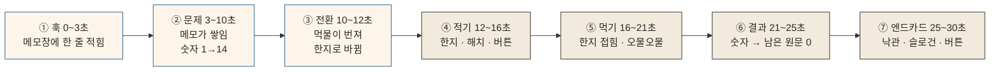
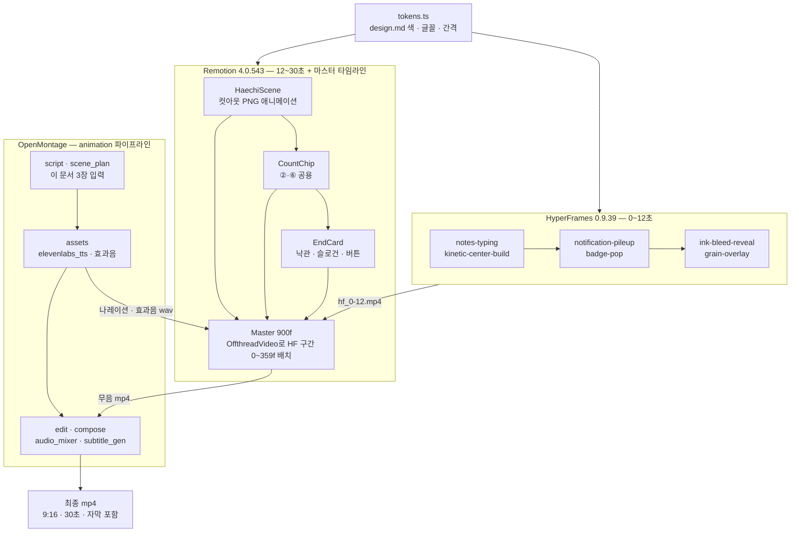

# 30초 모션그래픽 광고 기획안 — 해칫 (hatch eat) "남은 원문 0"

| 항목 | 내용 |
| --- | --- |
| 작성일 | 2026-11-25 |
| 작성자 | 정민규 (Claude Code로 작성) |
| 기준 문서 | [`PRD.md`](../PRD.md) v0.1, 해치 버전 초안 [`PRD_1006.md`](PRD_1006.md) v0.2 |
| 입력 | [`brand_1013.md`](brand_1013.md) 말투 · 금지어 12개 · 시각 방향, [`design.md`](design.md) 색 · 글꼴 토큰, [`copy_hatch_eat.md`](copy_hatch_eat.md) 슬로건 후보, [`영상장면표_김서영.md`](영상장면표_김서영.md) 30초 장면표 · 나레이션 v2 · 자막 규칙, [`카드뉴스_김서영.md`](카드뉴스_김서영.md) 확정 대본 |
| 원본 조사 | [`Research/outputs/경쟁사조사/`](../Research/outputs/경쟁사조사/), [`강의자료/w13-마케팅2-숫자로고치고영상으로.html`](../강의자료/w13-마케팅2-숫자로고치고영상으로.html) 릴스 · 쇼츠 규격 |
| 제작 도구 | Remotion 4.0.543 · HyperFrames 0.9.39 · OpenMontage (버전 `[미확인]`). **Blender는 쓰지 않는다** |
| 상태 | 기획안. 제작 전 팀 확인 필요 (맨 아래 "정할 것") |

---

## 결론

- **한 줄 콘셉트**: 메모장에 적은 말은 숫자가 계속 늘고, 해치에게 건넨 말은 숫자가 0이 된다.
- **핵심 장치는 화면 오른쪽 위 숫자 하나.** 앞 10초에는 메모 개수가 `1 → 14`로 올라가고, 해치가 먹은 뒤에는 같은 자리의 숫자가 `남은 원문 0`으로 내려간다. 말로 설명하지 않고 숫자의 방향으로 차이를 보여 준다.
- **김서영 장면표와 역할을 나눈다.** 그 영상은 점토 해치 AI 클립 위주의 에세이 톤(머뭇거림 → 맺음)이다. 이 안은 **글자 · 앱 화면 · 숫자로 끌고 가는 모션그래픽**이고, 소리 없이 봐도 이해되게 만든다. 둘을 같은 달에 번갈아 올려 어느 쪽이 더 많이 저장 · 공유되는지 비교할 수 있다.
- **도구 분담**: 앱 화면과 글자 효과가 많은 앞 12초는 HyperFrames 블록으로, 해치 캐릭터 · 숫자 · 엔드카드가 있는 뒤 18초는 Remotion으로 만든다. 나레이션 · 효과음 · 자막 · 최종 믹스는 OpenMontage `animation` 파이프라인으로 돌린다.

---

## 1. 광고 개요

| 항목 | 내용 |
| --- | --- |
| 목적 | "메모에 쓰면 남는다 → 해칫은 원문이 남지 않는다"는 차이를 30초 안에 한 번 각인 |
| 타깃 | 25~34세 사회초년생 · 이직/구직 준비생 (PRD 2장). 다만 카드뉴스 원칙대로 **취준생 한 사람의 이야기로 좁히지 않는다** |
| 집행 지면 | 인스타그램 릴스 · 유튜브 쇼츠 (추천 피드) |
| 규격 | 1080×1920 (9:16), 30fps, **30초 = 900프레임**. 안전 영역: 위아래 250px · 오른쪽 100px 안에 글자와 버튼 (w13 강의) |
| 소리 | 소리 없이 봐도 이해되게 화면 글자가 주인공. 나레이션은 선택 트랙 (5장) |
| 행동 유도 | 엔드카드 버튼 [해치에게 건네기]. 주소는 영상에 넣지 않고 프로필 링크 · 설명란에 둔다 (김서영 장면표 "만들기 전에 알아 둘 것" 1번 결정을 따름) |
| 톤 | 잔잔한 · 담백한 · 재촉하지 않는 (brand_1013). 빠른 컷은 쓰되 소리 · 움직임은 크지 않게 |

### 왜 "숫자"인가

- 쓰고 없애는 서비스는 이미 여럿 있다. Scream into the Void는 쓴 글을 사라지게 하고 [김서영] S1, 감정쓰레기통 계열도 즉시 삭제를 내세운다 [조재영/01]. "사라져요"만 말하면 이 영상은 누구의 광고인지 남지 않는다.
- 그래서 **비교 대상을 경쟁 앱이 아니라 사용자가 이미 쓰는 메모장**으로 잡는다. brand_1013의 스토리(9월 29일, 메모에 쓰려다 남는 게 싫어 그만둔 일)와 SNS 캡션 예시("메모장에 쓰면 남잖아요")가 이미 이 방향이다.
- 숫자 하나가 올라가다 0으로 떨어지는 것은 모션그래픽으로 만들기 쉽고, 소리 없이도 읽힌다. 브랜드스토리 4안("남는 원문 0개")의 문장을 화면 장치로 옮긴 것이다.

---

## 2. 스토리 흐름

- 테두리 파랑 = HyperFrames 구간(0~12초), 테두리 먹색 = Remotion 구간(12~30초).
- 감정의 흐름은 **답답함(쌓임) → 건넴 → 끝남** 세 단계뿐이다. 감정을 대신 말하는 문장("힘드시죠?")은 쓰지 않는다 (카드뉴스 원칙).

---

## 3. 스크립트 (장면표)

자막은 한 줄 12자 이내, 영상에 구워 넣는다 (w13 강의: 플랫폼 자동 자막은 꺼 둔 사람이 많다). 해치 말풍선은 하오체, 그 밖의 글자는 해요체다.

| # | 시간 (프레임) | 화면 | 화면 글자 (큰 글자 · 자막) | 소리 | 도구 |
| --- | --- | --- | --- | --- | --- |
| ① 훅 | 0:00~0:03 (0~90) | 한지 크림 바탕 가운데에 앱 이름 없는 메모 앱 화면. 커서가 깜빡이다가 글자 대신 **먹색 회색 막대**가 한 칸씩 타자 쳐진다 (내용은 읽히지 않게) | 큰 글자: **보내긴 애매한 말,** → **어디에 적어 두세요?** (어절마다 튀어 오름) | 폰 타자 소리 6~8회 | HyperFrames `notes-typing` + `kinetic-center-build` |
| ② 문제 | 0:03~0:10 (90~300) | 저장 → 메모 목록으로 줌아웃. 날짜만 보이는 메모 카드(9월 29일, 10월 3일 … 11월 24일)가 위에서 하나씩 떨어져 쌓이고 점점 빨라진다. 오른쪽 위 숫자 칩이 `메모 1 → 14`로 올라간다. 목록이 빠르게 흘러가다 멈추면 맨 위 📌 고정 메모가 그대로 있다 | **적으면,** (0:04) → **남아요.** (0:06) → **다음에 열어도 맨 위에.** (0:08) | 카드 한 장마다 작은 톡, 마지막에 핀 꽂히는 톡 | HyperFrames `notification-pileup`(카드 쌓임을 메모 카드로 바꿔 씀) + 숫자 칩 `badge-pop` |
| ③ 전환 | 0:10~0:12 (300~360) | 고정 메모 위로 먹물이 번져 화면 전체를 덮고, 먹물이 걷히면 한지 크림 바탕에 빈 한지 한 장이 놓여 있다 | **그럴 땐,** | 휙 + 먹 번지는 낮은 소리 | HyperFrames `ink-bleed-reveal`. 마지막 프레임은 **한지 크림 단색**으로 끝내 다음 구간과 이음매가 안 보이게 한다 |
| ④ 적기 | 0:12~0:16 (360~480) | 빈 한지에 붓 자국 세 줄이 한 획씩 그어진다(읽히지 않는 먹 선). 한지 위로 해치가 고개만 내민다(`haechi_wait.png`, 화면 높이 약 1/5). 말풍선이 그려지고, 아래에서 [해치에게 건네기] 버튼이 올라와 눌린다 | 말풍선: **적은 것은 아무도 읽지 않소** / 자막: **한지에 적어 해치에게** | 붓질 3회, 버튼 누름 | Remotion (붓 선: SVG `strokeDashoffset`을 `interpolate`로, 해치 등장: `spring`) |
| ⑤ 먹기 | 0:16~0:21 (480~630) | 한지가 두 번 접혀 작아지고 해치 쪽으로 날아간다. 해치가 `haechi_eat.png`로 바뀌며 세 번 오물거린다(세로 눌림-늘어남 3회). 한지가 입 안으로 줄어 사라지고 화면이 아주 살짝 흔들린다 | 큰 글자: **해치가 먹어요.** → 자막: **읽지도 않고요.** | 한지 접힘 2회, 오물오물 3회 | Remotion (접힘: `scaleY` 2단계 + 그림자, 오물거림: 프레임마다 `Math.sin` 기반 squash) |
| ⑥ 결과 | 0:21~0:25 (630~750) | 배부른 해치가 혼자 앉아 있다(`haechi_sit.png`). **②에서 보였던 숫자 칩이 같은 자리에 다시 나타나** `적은 글 3줄 → 남은 원문 0`으로 줄어든다. 0이 되는 순간 칩 테두리가 해치 블루로 바뀐다 | 말풍선: **잘 먹었소. 읽지는 않았소.** / 큰 글자: **원문은 남지 않아요.** | 숫자가 줄 때 작은 틱, 0에서 차임 1회 | Remotion (②와 같은 칩 컴포넌트를 props만 바꿔 재사용) |
| ⑦ 엔드카드 | 0:25~0:30 (750~900) | 해치가 아래로 작아지고, 위쪽 빈 공간에 주홍 낙관 **해칫**이 쾅 찍힌다(화면 3프레임 흔들림). 슬로건이 어절별로 올라오고, 마지막에 [해치에게 건네기] 버튼 | 슬로건: **해치가 먹으면 그날은 끝** / 작은 글자: **가입 없이 바로 적어요** | 낙관 쾅, 버튼 차임 | Remotion (로고 `haechi_yellow.png`, 낙관은 SVG) |

### 화면 글자만 이어 읽기

> 보내긴 애매한 말, 어디에 적어 두세요? 적으면, 남아요. 다음에 열어도 맨 위에. 그럴 땐, 한지에 적어 해치에게. (적은 것은 아무도 읽지 않소) 해치가 먹어요. 읽지도 않고요. (잘 먹었소. 읽지는 않았소.) 원문은 남지 않아요. 해치가 먹으면 그날은 끝.

### 문구 근거

| 문구 | 가져온 곳 |
| --- | --- |
| 보내긴 애매한 말 | 김서영 장면표 나레이션 v2 첫 문장. 두 영상의 첫마디를 맞춰 같은 브랜드로 읽히게 한다 |
| 적은 것은 아무도 읽지 않소 / 잘 먹었소. 읽지는 않았소. | brand_1013 해치 말풍선 예시, PRD_1006 5.1 |
| 원문은 남지 않아요 | brand_1013 금지어 11번이 정한 대체 표현 |
| 해치가 먹으면 그날은 끝 | copy_hatch_eat 최종 슬로건 1 |
| 해치에게 건네기 | design.md 기본 버튼 문구, 카드뉴스 10장 버튼 |
| 가입 없이 바로 적어요 | PRD_1006 5.1 "가입 없이 바로 한지 화면". 카드뉴스는 스펙을 뺐지만 광고 엔드카드는 행동 장벽을 낮추는 한 줄이 필요해서 넣었다 → "정할 것" 3번 |

### 금지어 점검 (brand_1013 12개)

힐링 · 치유 · 건강한 · 혁신적인 · 바쁜 현대인 · 진정한/특별한/따뜻한 · 종교 용어 · 연속 N일 · 오랜만이에요 · **태우다/소각** · **아무것도 남지 않아요** · 퇴치 — 위 스크립트에 하나도 쓰지 않았다. ③ 전환은 불이 아니라 **먹물**로 바꿨고, ②의 숫자는 "몇 번 왔는지"가 아니라 메모 앱의 메모 개수라 스트릭 금지와 부딪치지 않는다. 재촉하는 말("지금", "서두르세요", "!")도 없다.

---

## 4. 비주얼 가이드

`design.md` 토큰을 그대로 쓴다. 두 도구에서 같은 색이 나오도록 **토큰 파일 하나**(`tokens.ts` → HyperFrames에는 같은 값의 CSS 변수)로 관리한다.

| 항목 | 값 | 이 영상에서 쓰는 곳 |
| --- | --- | --- |
| 바탕 | 한지 크림 `#F2EBDD` | 전 구간 배경. 순백은 쓰지 않는다 |
| 표면 | 해치 아이보리 `#FDF5E9` | 메모 앱 화면, 한지, 말풍선 |
| 글자 | 먹 `#2A2826` | 큰 글자 · 자막 · 메모 회색 막대(60% 불투명) |
| 행동 | 해치 블루 `#2A6090` | 버튼, ⑥에서 0이 된 숫자 칩 테두리. **영상 전체에서 블루가 나오는 곳은 이 두 곳뿐** |
| 강조 | 골드 `#F0B237` · 레드 `#EB4531` | 해치 캐릭터 고유색만. 낙관은 레드 계열 주홍 1회 |
| 글꼴 | 영남일보체(YNAMNEWS) Medium, 강조 Bold. 없으면 고운돋움 | 렌더링하는 PC에 설치해서 영상에 구워 넣는다. 폰트 파일은 저장소에 올리지 않는다 (design.md 라이선스) |
| 질감 | HyperFrames `grain-overlay`를 아주 옅게(불투명도 6~8%) | 한지 결 대신. 전 구간 같은 값 |
| 캐릭터 | `Design/brand/key visual/cutout/` 의 `haechi_wait` · `haechi_eat` · `haechi_sit` PNG | 새로 그리지 않고 컷아웃을 2D로 움직인다 (squash · 위치 · 크기만) |
| 여백 | 화면의 2/3는 비운다 (brand_1013 빛과 공간) | 큰 글자는 위 1/3, 사물은 가운데~아래 |
| 하지 않는 것 | 사람 · 손, 불꽃, 실제 메모 앱(애플 메모 등)의 로고 · 화면 그대로 베끼기 | 메모 앱은 **이름 없는 일반 UI**로 그린다 |

### 움직임 규칙

| 규칙 | 값 |
| --- | --- |
| 큰 글자 등장 | 어절마다 아래에서 24px 올라오며 페이드, 어절 간격 4프레임 |
| 장면 전환 | 하드 컷 또는 8~10프레임 (김서영 영상의 0.28초 끊기와 맞춤). 예외는 ③ 먹물 전환 60프레임 |
| 캐릭터 | Remotion `spring({damping: 14})` 기본. 튀는 정도는 크지 않게 |
| 화면 흔들림 | ⑤ 마지막과 ⑦ 낙관에서만, 각 3프레임 · 최대 6px |
| 속도 곡선 | ②는 점점 빨라지고(쌓임의 답답함), ④~⑦은 점점 느려진다(끝남) |

---

## 5. 소리 · 나레이션

### 선택 트랙: 나레이션

소리 없이도 이해되게 만들되, 소리를 켠 사람을 위해 나레이션을 얹는다. 목소리는 팀이 이미 정한 **ElevenLabs Rosa Oh** (김서영 장면표 나레이션 v2)를 그대로 써서 두 영상이 같은 목소리로 들리게 한다.

> 보내긴 애매한 말, 어디에 적어 두세요? 적어 두면, 계속 남잖아요. 한지에 적어서 해치한테 주세요. 해치가 먹어요. 읽지도 않고요. 그날은 끝, 해칫.

- 76자 (띄어쓰기 포함, 문장부호 제외). 기준 80자 이내 (김서영 장면표와 같은 기준). 슬로건 전체는 화면 글자로 보여 주고, 나레이션은 "그날은 끝, 해칫"으로 줄였다.
- ⑥ "원문은 남지 않아요"는 나레이션에서 빼고 화면 숫자에 맡긴다. 같은 말을 글자와 목소리로 두 번 하지 않기 위해서다.

### 효과음 목록

김서영 영상에서 만든 9종(톡 · 휙 · 폰 타자 · 한지 내려앉음/접힘 · 붓질 · 오물오물 · 낙관 쾅 · 버튼 차임)을 먼저 재사용하고, 없는 것만 새로 만든다.

| 새로 필요한 소리 | 장면 |
| --- | --- |
| 먹물 번지는 낮은 소리 | ③ |
| 숫자 줄어드는 틱 (5~6회) | ⑥ |

### 음량

나레이션 최고 -2dB, 효과음 -4~-16dB, 음악은 목소리보다 작게, 전체 약 -17 LUFS (김서영 영상과 같은 기준). 음악은 상업 사용이 되는 곡만 쓴다.

---

## 6. 제작 계획 — 도구별 분담

### 6-1. 왜 이렇게 나눴나

| 도구 | 맡는 것 | 이유 |
| --- | --- | --- |
| **HyperFrames** | ① 훅 · ② 문제 · ③ 전환 (0~12초) | 메모 앱 타자(`notes-typing`), 카드 쌓임(`notification-pileup`), 먹물 번짐(`ink-bleed-reveal`)이 **이미 블록으로 있다** (`npx hyperframes catalog`로 2026-11-25 확인, 448개 중). 앱 화면처럼 HTML/CSS로 그리는 것이 더 정확한 장면이다. 김서영 장면표도 "폰 화면은 HTML 모션이 낫다"고 적었다 |
| **Remotion** | ④~⑦ (12~30초) + **전체를 합치는 마스터 타임라인** | 해치 컷아웃의 오물거림, 숫자 카운트다운, 낙관 같은 **프레임 단위로 맞춰야 하는 움직임**을 `useCurrentFrame` · `interpolate` · `spring`으로 정확히 맞출 수 있다. `D:\video-tools\remotion-video`에 렌더링용 브라우저까지 있어서 바로 렌더링된다. 숫자 칩을 컴포넌트 하나로 만들어 ②(HyperFrames 구간)와 ⑥에서 모양을 똑같이 맞춘다 → 6-3 |
| **OpenMontage** | 나레이션 · 효과음 생성, 자막 파일, 소리 믹스, 단계별 검수 | `animation` 파이프라인(research → proposal → script → scene_plan → assets → edit → compose → publish)에 `elevenlabs_tts`, `audio_mixer`, `subtitle_gen` 도구가 있다. 자체 Remotion(4.0.484)에는 렌더링 브라우저가 없으므로 **영상 렌더링은 remotion-video에서 하고**, OpenMontage는 소리 · 자막 · 최종 합치기만 맡긴다 |

### 6-2. 작업 순서

| 단계 | 할 일 | 도구 · 위치 | 결과물 |
| --- | --- | --- | --- |
| 0 | 이 문서 3장을 팀이 확정. 슬로건 · "가입 없이" 문구 결정 | 팀 | 확정 스크립트 |
| 1 | `tokens.ts` 만들기 (design.md 값 그대로) + 영남일보체 로컬 설치 확인 | Remotion 프로젝트 `src/brand/` | 토큰 파일 |
| 2 | HyperFrames 프로젝트 만들고 블록 4개 설치 → 메모 카드 · 숫자 칩 · 문구를 한국어와 브랜드 색으로 바꿈 | `npx hyperframes add notes-typing notification-pileup ink-bleed-reveal grain-overlay` | `hf_0-12.mp4` (360프레임) |
| 3 | Remotion에 `HaechiScene` · `CountChip` · `EndCard` 컴포넌트, `Master` 컴포지션(1080×1920, 30fps, 900프레임) | `D:\video-tools\remotion-video` | Studio 미리보기 |
| 4 | OpenMontage `animation` 파이프라인으로 나레이션(Rosa Oh) · 효과음 2종 생성 | `D:\video-tools\OpenMontage` | wav 파일, 자막 시간표 |
| 5 | 나레이션 시간에 맞춰 Remotion 장면 길이 조정 → 무음 mp4 렌더링 | `npx remotion render Master` | `master_silent.mp4` |
| 6 | 소리 믹스 + 자막 굽기 + 규격 검수 (안전 영역 · -17 LUFS · 30초 이하) | OpenMontage compose · publish | 최종 mp4 |
| 7 | 파생 컷 만들기 (7장) | Remotion props만 바꿔 다시 렌더링 | 15초 · 6초 |

### 6-3. 이음매 처리

- ③의 마지막 프레임과 ④의 첫 프레임은 둘 다 **한지 크림 단색 + 같은 위치의 빈 한지**로 맞춘다. 그래서 두 도구의 결과를 이어도 컷이 보이지 않는다.
- ②의 숫자 칩(HyperFrames)과 ⑥의 숫자 칩(Remotion)은 크기 · 위치 · 글꼴을 `tokens.ts` 한 곳에서 가져온다. HyperFrames 쪽은 같은 값을 CSS 변수로 옮겨 적는다. 두 칩이 다르게 보이면 "같은 숫자가 0이 됐다"는 장치가 깨지므로 **제작 검수 1순위**다.
- HyperFrames 결과를 투명 배경으로 뽑을 수 있는지는 확인하지 않았다 `[미확인]`. 이 계획은 투명 배경 없이 구간을 이어 붙이는 방식이라 그 기능이 없어도 된다.

### 6-4. 렌더링 엔진 결정

OpenMontage 규칙(`AGENT_GUIDE.md`)은 Remotion과 HyperFrames가 둘 다 있으면 **어느 쪽으로 최종 합성할지 사용자에게 묻고 정하라**고 한다. 이 기획안은 **Remotion을 최종 합성 엔진으로 제안**한다. 캐릭터 · 숫자 구간이 Remotion이고, 렌더링 브라우저가 이미 설치된 쪽이기 때문이다. 파이프라인을 돌릴 때 proposal 단계에서 이 선택을 기록한다.

---

## 7. 파생 소재

같은 Remotion 프로젝트에서 props(`variant`)만 바꿔 만든다.

| 버전 | 길이 | 구성 | 쓰는 곳 |
| --- | --- | --- | --- |
| 메인 | 30초 | ①~⑦ 전부 | 릴스 · 쇼츠 |
| 컷다운 | 15초 | ①(2초) → ②(4초, 숫자 1→9) → ⑤(4초) → ⑥(2초) → ⑦(3초). ③ · ④ 생략, 한지는 하드 컷으로 등장 | 스토리 · 광고 피드 |
| 범퍼 | 6초 | ⑤ 먹기(3초) → ⑥ 숫자 0(1.5초) → 낙관(1.5초) | 유튜브 6초 범퍼, 반복 노출용 |

---

## 8. 검증 · 비교 방법

| 항목 | 방법 |
| --- | --- |
| 이해도 (제작 전) | 팀 밖 3~5명에게 **소리 끄고** 메인 30초를 보여 준 뒤 "이 앱은 뭘 해 주는 앱이에요?"를 묻는다. "적은 글이 안 남는다"를 말하면 통과 |
| 숫자 장치 | 같은 사람에게 "오른쪽 위 숫자가 뭐였어요?"를 묻는다. ②와 ⑥을 같은 숫자로 기억하면 장치가 통한 것이다 |
| 영상 비교 (집행 후) | 김서영 에세이 영상과 이 영상을 같은 기간 올려 **저장 수 · 공유 수 · 프로필 링크 클릭**을 비교한다 (w13 강의: 릴스는 공유가 높은 지면). 조회수만으로 판단하지 않는다 |
| 브랜드 검수 | 최종본 글자를 brand_1013 금지어 12개와 다시 대조. 해치 말풍선이 하오체 한 줄인지 확인 |

---

## 9. 정할 것

| # | 질문 | 이 안의 제안 |
| --- | --- | --- |
| 1 | ②에서 메모 카드에 **날짜**를 보여 줘도 되는가 (9월 29일은 실제 스토리 날짜) | 보여 준다. 내용은 회색 막대로 가려 사적인 글처럼 읽히지 않게 한다 |
| 2 | 슬로건을 "해치가 먹으면 그날은 끝"으로 할 것인가 | copy_hatch_eat 최종 후보 1. 엔드카드가 짧아 15자 이내 슬로건이 맞다 |
| 3 | 엔드카드에 "가입 없이 바로 적어요"를 넣을 것인가 | 넣는다. 카드뉴스는 스펙을 뺐지만, 광고 끝에는 바로 눌러 볼 이유가 한 줄 필요하다. 팀이 빼기로 하면 슬로건만 남긴다 |
| 4 | 영상 속 메모 앱 화면을 어디까지 닮게 할 것인가 | 이름 · 아이콘 없는 일반 메모 UI. 특정 앱 화면을 그대로 베끼지 않는다 |
| 5 | 서비스 주소 | 영상에는 넣지 않는다. 지금 주소의 "incinerator(소각)"는 금지어 10번과 겹쳐 바꾸는 것을 권한다는 김서영 장면표 의견에 동의 `[확인 필요]` |
| 6 | 나레이션을 넣을 것인가 | 무음판과 나레이션판 둘 다 뽑는다. 릴스 기본은 나레이션판, 소리 없이 재생되는 광고 지면은 무음판 |
