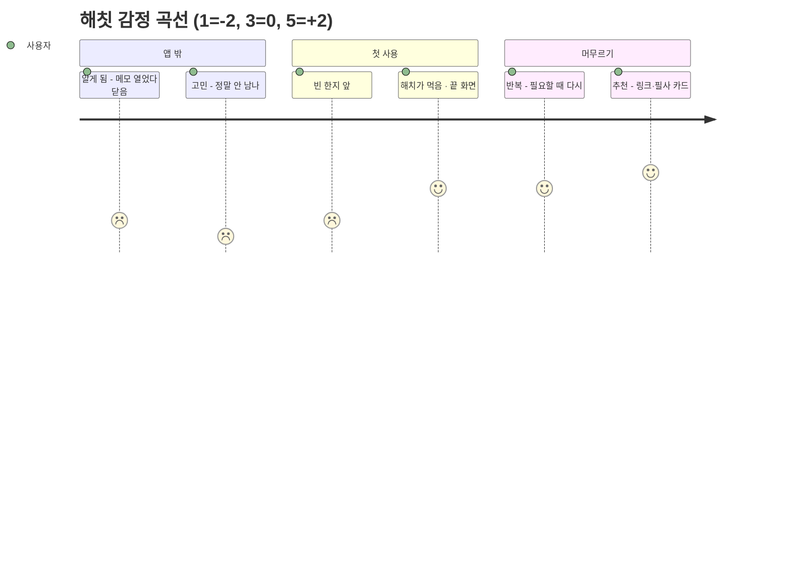

# 여정 맵 — 해칫 (hatch eat) 사용자 여정 · 정보 구조 · 흐름 카드

| 항목 | 내용 |
| --- | --- |
| 작성일 | 2026-10-13 |
| 작성자 | 정민규 (Claude Code로 작성) |
| 기준 문서 | [`PRD_1006.md`](PRD_1006.md) v0.2 (루트 [`PRD.md`](../PRD.md) 반영 전 초안) |
| 참고 | [`brand_1013.md`](brand_1013.md) — 한 줄 소개·스토리·말투·금지어, [`유저플로우_정민규(1012).md`](유저플로우_정민규(1012).md) — 화면 ID S1~S8, [`design_1013.md`](design_1013.md) — 버튼·빈 화면 문구 |
| 원본 조사 | 없음. 새 조사 없이 PRD·brand를 여정과 화면으로 옮겼다. 사용자 인터뷰가 0건이므로(PRD 2) 여정 맵의 **생각·감정 점수는 가설**이다 `[미확인]` |

`PRD N`은 `PRD_1006.md`의 해당 절, `S1`~`S8`은 유저플로우 문서의 화면 ID다. PRD에 없는 내용을 채운 곳은 `[제안]`을 붙였다.

## 출발점 (brand_1013)

**한 줄 소개**: 털어놓고 싶지만 기록이 남는 건 싫은 사람이 남겨두기 싫은 말을 한지에 적으면, 해치가 먹어 없애 원문이 남지 않는 끝맺음을 받는 서비스

**스토리**: 모든 마음을 기록해 둘 필요는 없다. 그런데 메모 앱에 속상한 일을 적으면 그 글은 목록 맨 위에 남고, 버리려고 쓴 말이 오히려 또 하나의 기록이 된다. 팀원인 민규님이 9월 29일, 기분 좋지 않은 일을 겪고 부정적 감정을 털어놓기 위해 메모에 작성하려던 것을 그만둔 것도 메모에 쓰게 되면 기록으로 남아 계속 존재하기 때문이었다. 그래서 한지에 적어 해치에게 건네면 해치가 먹어 없애고, 원문은 어디에도 남지 않는 곳을 만들었다. 해치는 옛 궁궐 앞에서 화기와 나쁜 기운을 막던 수호 동물이다. 마음이 남으면 먹을 갈며 조금 더 머물 수 있다. 몇 번 왔는지 세지 않고, 한동안 오지 않아도 잃는 것이 없다.

**핵심 과업** (사용자가 반드시 끝내야 할 행동 하나): 스트레스 받았던 일을 한지에 적어 해치에게 건네고, 해치가 그것을 먹는 것을 보고 끝맺는다.
완료 기준 = **S4 끝 화면**("잘 먹었소. 읽지는 않았소")이 뜬 순간.

---

## ① 여정 맵

감정 점수: -2(가장 나쁨) ~ +2(가장 좋음). **화면 필요** = 감정이 올라와야 하는 단계라서 앱 안에 그 역할을 맡는 화면이 있어야 하는 곳.

| 단계 | 행동 | 생각 | 감정 | 접점 | 아픈 곳 | 화면 필요 |
| --- | --- | --- | --- | --- | --- | --- |
| **1. 알게 됨** | 속상한 일을 겪고 메모 앱을 열었다가 닫는다. SNS나 지인 메시지에서 해칫 캡션을 본다 | "누구한테 말하기는 부담스럽고, 메모에 쓰면 계속 남잖아" | **-1** | SNS 캡션, 지인 메시지, 랜딩 페이지 | 털어놓을 곳이 없다. 쓰면 기록이 남는다 (PRD 3-1·3-2) | — (앱 밖. 랜딩 문구가 아직 "감정소각소"라 수정 필요, PRD 11-2) |
| **2. 고민** | 랜딩·스토어 설명을 읽고 설치할지 망설인다 | "정말 안 남아? 또 가입하고 권한 줘야 하나?" | **-2** (가장 낮음) | 랜딩 페이지, 스토어 설명 | 원문을 보관하지 않는다는 말을 믿기 어렵다. 가입·권한 요구가 귀찮다 | — (앱 밖. 랜딩에 "가입 없이 바로", "원문은 남지 않아요"를 첫 줄에) |
| **3. 첫 사용** | 열자마자 한지가 보인다 → 적는다 → 해치에게 건넨다 → 해치가 먹는다 | "진짜 가입이 없네" → "다 적었다" → "해치가 먹었다. 이제 됐다" | **-1 → +1** | S1 한지 화면, S3 먹는 연출, S4 끝 화면 | 빈 한지 앞에서 무엇을 쓸지 막막하다. 실패하면 쓴 글이 날아갈까 불안하다 | ✅ **S1 한지 화면 · S4 끝 화면** (감정이 가장 크게 올라야 하는 곳) |
| **4. 반복** | 다음에 힘든 일이 있을 때 다시 연다. 마음이 남으면 먹을 간다 | "지난번에 적고 나니 괜찮았지" / "글은 안 남았는데 먹은 조금씩 진해지네" | **+1** | 홈 화면의 앱 아이콘, S1, S5 먹 갈기, S6 필사 카드 | 알림이 없어서 잊힌다(알림은 MVP 제외, PRD 10). 먹 갈기가 숙제처럼 느껴질 수 있다 | ✅ **S1(다시 와도 처음과 같은 화면) · S6 필사 카드** |
| **5. 추천** | 비슷한 일을 겪은 친구에게 링크를 보낸다. 받은 필사 카드를 보여 준다 | "내가 쓴 글은 어디에도 없으니 편하게 권할 수 있다" | **+2** | 메신저, 랜딩 링크, 필사 카드 이미지 `[제안]` | 원문이 없으니 보여 줄 것이 없다. 권하면 "너 요즘 힘들어?"로 읽힐까 걱정된다 | ✅ **S6 필사 카드 → 이미지로 저장** `[제안]` (공유되는 것은 고전 구절뿐, 원문은 절대 아님) |



**읽는 법**: 바닥은 2단계 "고민"(-2)이고, 앱이 처음 감정을 끌어올릴 기회는 3단계 끝의 **S4 끝 화면** 하나다. 그래서 핵심 과업 경로는 S4까지 최대한 짧아야 하고, 그 앞에 가입·온보딩·선택지를 두면 바닥에서 올라오기 전에 이탈한다.

---

## ② 정보 구조도

★ = 핵심 과업 경로 · `[탭]` = 탭바 후보 · `(d1)` `(d2)` `(d3)` = 깊이

```
해칫
├── 한지 [탭] ★                                   ← 앱을 열면 바로 여기 (홈 = 한지 화면)
│   ├── (d1) 한지 화면 · 빈 한지 / 쓰는 중  S1·S2 ★
│   │   └── (전환) 먹는 연출 S3 ★                 ← 결정이 없는 연출. 화면 깊이에 세지 않는다
│   └── (d2) 끝 화면  S4 ★ ── 핵심 과업 완료
│
├── 먹 갈기 [탭]
│   ├── (d1) 벼루  S5
│   └── (d2) 필사 카드  S6
│       └── (d3) 이미지로 저장 `[제안]`
│
├── 필사첩 [탭]
│   ├── (d1) 카드 목록  S7 (비었을 때 빈 화면 문구)
│   └── (d2) 카드 하나 보기
│       └── (d3) 이미지로 저장 `[제안]`
│
└── 설정 (탭 아님 — 필사첩 오른쪽 위 작은 진입점)
    ├── (d1) 책 고르기  S8 (랜덤 기본)
    ├── (d1) 데이터 안내 "원문은 남지 않아요 · 필사첩은 이 기기에만 있어요"
    ├── (d1) 해치 사진 (P1)
    └── (d1) 계정·백업 — MVP 없음. 생긴다면 여기 (다음 단계, PRD 10)
```

| 가지 | 묶은 기준 | 가장 깊은 곳 |
| --- | --- | --- |
| 한지 ★ | 핵심 과업(적고 건네고 끝맺기) | **2** (S1 → S4) |
| 먹 갈기 | 마음이 남을 때 머무르기 (PRD 5.2) | 3 |
| 필사첩 | 기기에 남는 것 보기 | 3 |
| 설정 | 한 번 정하면 거의 안 오는 것 | 1 |

- **탭바 후보**: 한지 · 먹 갈기 · 필사첩 (3개). 설정은 탭에 올리지 않는다
- `[제안]` **쓰는 중(S2)에는 탭바를 숨긴다.** 키보드와 한지만 남겨 "여백"(brand 무드)을 지키고, 다른 데로 새는 탭을 없앤다
- 유저플로우 문서의 "한지 화면 구석 작은 진입점" 안과 탭바 안 중 어느 쪽으로 갈지는 팀 결정이 필요하다 (아래 오픈 이슈 1)

---

## ③ 흐름 카드

진입 → 핵심 과업 완료까지. 카드 하나 = 결정 하나.

| # | 화면 이름 | 이 화면에서 내리는 결정 하나 | 미리 채워 둔 기본값 | 이탈 위험 → 대책 |
| --- | --- | --- | --- | --- |
| 0 | (진입) 앱 아이콘 · 랜딩 링크 | — (앱 밖) | — | **가입 벽** → 가입·로그인·권한 요청 없이 바로 카드 1로 연다 |
| 1 | **한지 화면 · 빈 한지** (S1) | "여기에 적어도 괜찮은가?" → 한지를 누른다 | 한지 바탕, 해치(화면 높이 약 2/5), 말풍선 "적은 것은 아무도 읽지 않소", 한지 안 안내 "남겨두기 싫은 말을 여기에 적어 보세요. 적은 글은 어디에도 저장되지 않아요." | **빈 결과**(빈 한지 앞의 막막함) → 안내 문구를 한지 안에 미리 깔아 둔다. 보관 범위를 입력 **전에** 말해 신뢰를 먼저 준다 |
| 2 | **한지 화면 · 쓰는 중** (S2) | "이 글을 해치에게 건넬까?" → [해치에게 건네기] | 커서가 한지 첫 줄에, 해치는 1/5 크기로 고개만, 버튼은 아래 고정·1자 이상이면 활성, 글자 수 제한 없음, 제목·날짜·감정 태그 같은 칸 없음 | **긴 폼** → 입력 칸은 한지 하나뿐, 필수 항목 없음. 실패해도 쓴 글은 그대로 둔다("해치가 아직 받지 못했어요. 적은 글은 그대로 있으니 한 번 더 건네 주세요.") |
| — | (전환) 먹는 연출 (S3) | 없음 — 보기만 한다. 결정이 없으므로 **독립 화면이 아니라 2 → 3 사이 전환**으로 둔다 | 한지가 접히고 해치가 받아먹는 연출 1종, 약 5초, 진동 | 해당 없음. 연출 중 앱을 닫으면 먹이기 성공으로 본다 (유저플로우 2.3) |
| 3 | **끝 화면** (S4) ✅ 완료 | "여기서 끝낼까, 조금 더 머물까?" → [닫기] / [먹 갈러 가기] | 배부른 해치 + 말풍선 "잘 먹었소. 읽지는 않았소", primary = [닫기](빈 한지로 돌아감), [먹 갈러 가기]는 보조 버튼 | **가입 벽**(여기에 가입·평가 요청을 붙이고 싶은 유혹) → 붙이지 않는다. 계정이 생긴다면 설정의 "계정·백업"에, 필사첩에 카드가 쌓인 뒤에만 보여 준다 |

### 탭 수

| 순서 | 동작 | 탭 |
| --- | --- | --- |
| 앱 열기 | 카드 1 한지 화면이 바로 뜬다 | 0 (아이콘 누르기는 세지 않음) |
| 카드 1 → 2 | 한지를 누른다 (키보드가 올라옴) | **1** |
| 카드 2 | 글자를 친다 | (타자는 세지 않음) |
| 카드 2 → 3 | [해치에게 건네기] | **2** |
| 전환 → 카드 3 | 연출이 끝나면 끝 화면이 자동으로 뜬다 | 0 |
| **합계** | | **2탭 — 3탭 이하 ✅** |

3탭을 넘기지 않으므로 지금 흐름에서 더 없앨 화면은 없다. 대신 **3탭을 넘게 만들 뻔한 화면을 이미 뺐다** (아래 검증 표). 누가 다시 넣자고 하면 그 화면이 빠져야 한다.

- 더 줄이는 안: 앱을 열 때 키보드를 자동으로 올리면 1탭이 된다. `[제안]` **쓰지 않는다.** 키보드가 해치를 가리고 말풍선 안내를 읽기 전에 쓰라고 재촉하게 된다 (brand 말투 "재촉하지 않는")

### '결과 없음' 화면 — 빈 한지에서 건네려 할 때

핵심 과업 경로에서 "결과가 없는" 유일한 경우는 **아무것도 적지 않은 한지**다. 해치가 먹을 것이 없다.

```
┌──────────────────────────────┐
│                              │
│        ( 해치, 2/5 크기 )       │
│   ╭────────────────────╮     │
│   │ 아직 먹을 것이 없소    │     │  ← 해치 말풍선 (하오체, 한 줄)
│   ╰────────────────────╯     │
│ ┌──────────────────────────┐ │
│ │ 남겨두기 싫은 말을         │ │  ← 한지 안 안내 (해요체, 옅은 먹색)
│ │ 여기에 적어 보세요.        │ │
│ │ 적은 글은 어디에도         │ │
│ │ 저장되지 않아요.           │ │
│ └──────────────────────────┘ │
│                              │
│ [   해치에게 건네기 (비활성)   ] │  ← muted 40%, 누르면 아래 한 줄만
│ 한지가 비어 있어요. 한 글자라도  │
│ 적으면 건넬 수 있어요.          │
└──────────────────────────────┘
```

| 항목 | 내용 |
| --- | --- |
| 언제 | 빈 한지 또는 공백만 있는 상태에서 비활성 버튼을 누를 때 |
| 보이는 것 | 해치(원래 크기), 말풍선, 한지 안 안내, 비활성 버튼 아래 한 줄 |
| 문구 | 말풍선 `[제안]` "아직 먹을 것이 없소" / 버튼 아래 "한지가 비어 있어요. 한 글자라도 적으면 건넬 수 있어요." (design_1013 에러 문구 2) |
| 할 수 있는 것 하나 | 한지를 누르면 바로 쓰는 중(카드 2)으로 간다. 닫을 버튼·다른 길을 따로 두지 않는다 |
| 하지 않는 것 | 경고색(danger), 진동, 흔들림 효과. 아무것도 안 적은 것은 잘못이 아니다 |

`[제안]` 유저플로우 2.3은 "경고 문구는 띄우지 않는다"고 했다. 이 문서는 **비활성 버튼을 눌렀을 때만** 한 줄을 띄우자고 제안한다. 왜 안 눌리는지 모르면 고장으로 읽히기 때문이다. 팀 확인 필요.

---

## 검증 — "이 화면이 없으면 핵심 과업이 안 되나?"

| 화면 · 요소 | 없으면 핵심 과업이 안 되나? | 결정 |
| --- | --- | --- |
| 한지 화면 · 빈 한지 (카드 1) | 안 된다. 적을 곳이 없다 | **남김** |
| 한지 화면 · 쓰는 중 (카드 2) | 안 된다. 건넬 수가 없다 | **남김** (카드 1과 같은 화면의 상태 변화. 새 화면을 띄우지 않는다) |
| 먹는 연출 (S3) | 안 된다. "해치가 먹는다"를 보는 것이 끝맺음이다 | **남김 — 단, 화면이 아니라 전환으로 강등** (결정이 없으므로) |
| 끝 화면 (카드 3) | 안 된다. 다 먹었다는 확인이 없으면 글이 어디 갔는지 불안하다 | **남김** |
| 별도 홈 화면 (PRD 6의 "홈") | 된다. 한지 화면이 홈 역할을 한다 | **삭제** (있으면 +1탭) |
| 온보딩 · 캐릭터 소개 슬라이드 | 된다. 말풍선 한 줄이 같은 일을 한다 | **삭제** (제약) |
| 가입 · 로그인 | 된다. 원문을 저장하지 않으니 계정이 필요 없다 | **삭제** (MVP 없음. 생긴다면 설정 안, 핵심 과업 뒤) |
| "정말 건넬까요?" 확인 창 | 된다. 실패해도 글이 그대로 있으니 되돌릴 일이 없다 | **삭제** (있으면 +1탭) |
| 처리 방식 고르기 (분쇄기·화로·물) | 된다 | **삭제** (PRD 5.1 "연출은 1종만") |
| 감정 태그 · 제목 칸 | 된다 | **삭제** (긴 폼, PRD 10) |
| "조금 가벼워졌나요?" 5점 응답 | 된다 | **핵심 경로에서 뺌** — 소규모 테스트 때만 끝 화면 아래에, 건너뛸 수 있게 (PRD 4) |
| 먹 갈기 · 필사 카드 · 필사첩 · 설정 | 된다 | **핵심 경로 밖** — 구조도에는 남기되 끝 화면 이후 사용자가 고를 때만 (PRD 5.2) |

---

## 오픈 이슈

| # | 항목 | 할 일 |
| --- | --- | --- |
| 1 | **탭바 vs 구석 진입점**: 이 문서는 탭바 후보 3개(한지·먹 갈기·필사첩)를 냈고, 유저플로우 문서는 한지 화면 구석에 작은 진입점을 두자고 했다 | 팀 결정. 어느 쪽이든 핵심 과업 탭 수(2탭)는 같다 |
| 2 | **빈 한지 안내 한 줄**: 비활성 버튼을 누를 때만 한 줄 띄우기 (유저플로우 2.3과 다름) | 팀 확인 |
| 3 | **필사 카드 이미지 저장**: 추천 단계의 접점으로 제안. PRD에 없다 | PRD 반영 여부 결정. 원문은 절대 포함하지 않는다 |
| 4 | **고민 단계(-2)는 앱 밖**: 랜딩 문구가 아직 "감정소각소", "쓰고, 태우면 끝"이다 (PRD 11-2) | 랜딩 첫 줄을 "가입 없이 바로 · 원문은 남지 않아요"로 |
| 5 | **감정 점수는 가설**: 인터뷰 0건 | 5명 인터뷰 때 단계별 감정을 물어 이 표를 고친다 (PRD 11-8) |
