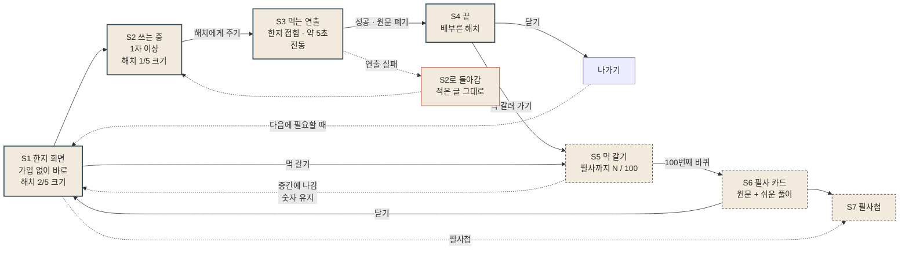
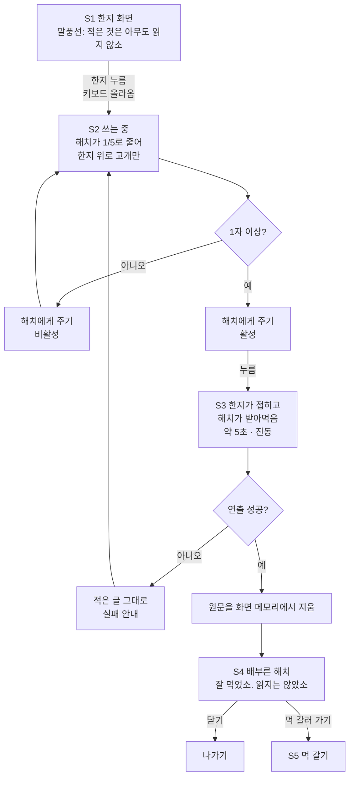
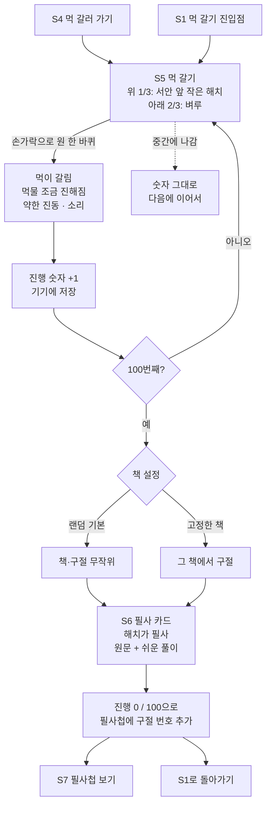

# 유저 플로우 — 해치가 먹기 · 먹 갈기

| 항목 | 내용 |
| --- | --- |
| 작성일 | 2026-10-12 |
| 작성자 | Nankku (Claude Code로 작성) |
| 기준 문서 | [`PRD_1006.md`](PRD_1006.md) v0.2 (루트 [`PRD.md`](../PRD.md) 반영 전 초안) |
| 참고 | [`brand_1006.md`](brand_1006.md) — 말투·금지어·컬러, [`해치MVP기획안_정연화.md`](해치MVP기획안_정연화.md) |
| 원본 조사 | [`Research/outputs/경쟁사조사/`](../Research/outputs/경쟁사조사/) — 이 문서는 새 조사 없이 PRD와 brand를 화면 흐름으로 옮겼다 |
| 범위 | MVP 기능 두 개(① 해치가 먹기 ② 먹 갈기)의 화면 단위 흐름, 분기·예외, 화면별 문구, 기기 저장 데이터 |

`PRD N`은 `PRD_1006.md`의 해당 절, `brand`는 `brand_1006.md`다. PRD에 없는 내용을 이 문서에서 채운 곳은 `[제안]`을 붙였다. 팀 확인 전까지는 확정이 아니다.

---

## 한눈에 보기

- 굵은 쪽빛 테두리: 핵심 흐름(해치가 먹기). 점선 테두리: 머무르기(먹 갈기). 주홍 테두리: 예외
- 사용자가 반드시 지나는 길은 **S1 → S2 → S3 → S4** 하나뿐이다. 먹 갈기는 **사용자가 고를 때만** 들어간다 (PRD 5.2)

---

## 1. 화면 목록

| ID | 화면 | 들어오는 곳 | 나가는 곳 | 기능 |
| --- | --- | --- | --- | --- |
| S1 | 한지 화면 (홈) | 앱 열기, S4 닫기 뒤 다시 열기, S5·S6에서 돌아오기 | S2, S5, S7 | ① |
| S2 | 쓰는 중 | S1에서 한지 누르기, S3 실패 | S3 | ① |
| S3 | 먹는 연출 | S2 "해치에게 주기" | S4, S2(실패) | ① |
| S4 | 끝 | S3 성공 | 나가기, S5 | ① |
| S5 | 먹 갈기 | S4 "먹 갈러 가기", S1 | S6, S1 | ② |
| S6 | 필사 카드 | S5 100번째 바퀴 | S7, S1 | ② |
| S7 | 필사첩 | S6, S1 | S1 | ② |
| S8 | 설정 (책 고르기) | S5 또는 S7 `[제안]` | 이전 화면 | ② |

`[제안]` **홈은 S1(한지 화면)으로 둔다.** PRD 6의 흐름에는 "홈"이 따로 있지만 화면 정의가 없다. 별도 홈을 만들면 쓰기까지 한 단계가 늘어나므로, 한지 화면 구석에 [먹 갈기]·[필사첩] 진입점을 작게 두는 쪽을 제안한다 (brand "여백: 버튼과 장식은 최소").

---

## 2. 기능 ① 해치가 먹기

### 2.1 흐름

### 2.2 화면별 내용

| 화면 | 보이는 것 | 문구 | 근거 |
| --- | --- | --- | --- |
| S1 | 한지 바탕, 한지 뒤에서 기다리는 해치(화면 높이 약 2/5), 해치 말풍선 | 말풍선: "적은 것은 아무도 읽지 않소" / 안내 `[제안]`: "한지에 적으면 해치가 먹어요. 적은 글은 어디에도 저장되지 않아요." | PRD 5.1, brand 예시 |
| S2 | 키보드, 한지 입력란(글자 수 제한 없음), 한지 위로 고개만 내민 해치(약 1/5), "해치에게 주기" 버튼 | 버튼: "해치에게 주기" | PRD 5.1 |
| S3 | 한지가 접히고 해치가 받아먹는 연출 1종, 약 5초, 진동 | 없음 `[제안]` — 연출 중에는 글을 띄우지 않는다 | PRD 5.1 |
| S4 | 배부른 해치, 버튼 두 개 | 말풍선: "잘 먹었소. 읽지는 않았소" / 버튼: [닫기] [먹 갈러 가기] | PRD 5.1 |

### 2.3 분기와 예외

| 상황 | 처리 | 근거 |
| --- | --- | --- |
| 아무것도 안 씀 / 공백만 | "해치에게 주기" 비활성. 경고 문구는 띄우지 않는다 `[제안]` | PRD 5.1 "1자 이상" |
| 연출 실패 | 쓴 글을 그대로 두고 S2로 돌아간다. "해치가 아직 받지 못했어요. 적은 글은 그대로 있으니 한 번 더 건네 주세요." | PRD 5.1, brand 예시 |
| 쓰다가 앱을 닫음 / 다른 앱으로 감 | `[제안]` 쓰던 글은 저장하지 않는다(임시 저장 없음). 원문을 기기에 남기지 않는다는 원칙(PRD 7)을 지키기 위해서다. 다시 열면 빈 한지 | PRD 7 |
| 연출 도중 앱을 닫음 | `[제안]` 먹이기 성공으로 본다. 원문은 메모리에서 이미 버려지고 다시 열면 S1 | PRD 7 |
| 쓰다가 그만두고 싶음 | `[제안]` S2에 [그만 쓰기]를 따로 두지 않는다. 키보드를 내리면 S1처럼 해치가 다시 커지고, 글은 화면에만 있다 | — |
| 긴 글 | 제한 없음. 한지가 아래로 늘어나고 스크롤된다 `[제안]` | PRD 5.1 |
| 다시 온 사용자 | 처음 온 사용자와 같은 S1. "오랜만이에요", 방문 횟수 같은 부재·횟수 문구를 띄우지 않는다 | PRD 9, brand 금지어 9 |

### 2.4 소규모 테스트에서만

| 위치 | 내용 | 근거 |
| --- | --- | --- |
| S4 아래 | "조금 가벼워졌나요?" 5점 응답. 건너뛸 수 있다 `[제안]` | PRD 4 보조 지표 |

---

## 3. 기능 ② 먹 갈기

### 3.1 흐름

### 3.2 화면별 내용

| 화면 | 보이는 것 | 문구 | 근거 |
| --- | --- | --- | --- |
| S5 | 아래 2/3 벼루, 위 1/3 서안 앞에 앉은 작은 해치, 진행 표시. 먹물 농담이 곧 진행 표시 | "필사까지 37 / 100" / 바퀴가 쌓일 때 `[제안]`: "먹이 조금 진해졌어요." | PRD 5.2, brand 시각 방향 "먹빛", brand 예시 |
| S6 | 해치가 쓴 고전 한 구절, 원문 + 쉬운 풀이, 단청 주홍 낙관(작게) | 버튼 `[제안]`: [필사첩에서 보기] [닫기] | PRD 5.2, brand 컬러 |
| S7 | 모인 필사 카드 목록 | 비어 있을 때 `[제안]`: "먹을 100번 갈면 해치가 한 구절을 옮겨 적어요." | PRD 5.2 |
| S8 | 책 고르기: 랜덤(기본) / 논어 · 맹자 · 명심보감 · 소학 · 채근담 · 도덕경 중 하나 고정 | — | PRD 5.2 (후보 초안) |

### 3.3 원칙과 예외

| 상황 | 처리 | 근거 |
| --- | --- | --- |
| 중간에 나감 | 진행 숫자는 줄지 않는다. 다시 들어오면 이어서 간다 | PRD 5.2 |
| 오래 안 옴 | 숫자·필사첩 그대로. 경고, 연속 기록, 압박 문구 없음 | PRD 5.2, PRD 9 |
| 먹이기 횟수와의 관계 | 연결하지 않는다. 먹이기를 많이 해도 먹이 빨리 갈리거나 보상이 늘지 않는다 | PRD 5.2, PRD 9 |
| 원이 아닌 짧은 문지르기 | `[제안]` 한 바퀴로 세지 않는다. 몇 도 이상 돌아야 한 바퀴인지는 개발에서 정한다 | — |
| 고정한 책의 구절을 다 씀 | `[확인 필요]` PRD에 없다. 같은 책에서 처음부터 다시 / 랜덤으로 넘어가기 중 결정 필요 | — |
| 앱을 지움 | 기기 저장이므로 진행 숫자·필사첩이 사라진다. `[제안]` S7 또는 S8에 "필사첩은 이 기기에만 있어요." 한 줄 | PRD 7 |
| P1 해치 사진 | 해치 얼굴 자리에 사용자 사진. 사진은 기기에만 저장. 진입 위치는 S8 `[제안]` | PRD 5.2 |

---

## 4. 단계별로 남는 데이터

| 단계 | 기기에 저장 | 저장하지 않음 |
| --- | --- | --- |
| S2 쓰기 | — | 원문 (임시 저장 포함) |
| S3 먹이기 | — | 원문, 글자 수 `[제안]`, 먹인 횟수 `[제안]` |
| S5 먹 갈기 | 먹 진행 횟수 | — |
| S6 필사 | 필사 횟수, 필사첩 구절 번호 | — |
| S8 설정 | 고른 책 설정, (P1) 해치 사진 | — |
| 서버 | MVP에서는 쓰지 않는다 (랜딩 출시 알림 이메일은 별도) | 전부 |

`[제안]` 먹인 횟수는 PRD 7의 "기기에만 저장" 목록에 없으므로 세지 않는다. 주 지표("2주 안에 2번 이상 다시 사용")는 소규모 테스트에서 관찰과 자가 보고로 잰다 (PRD 4).

---

## 5. 문구 점검 (brand 금지어)

이 문서의 화면 문구는 brand 금지어를 쓰지 않았다. 화면을 만들 때 특히 걸리기 쉬운 것만 다시 적는다.

| 쓰지 않는 말 | 대신 쓰는 말 |
| --- | --- |
| 태우다 · 소각 | 해치가 먹는다 · 해치에게 주기 |
| 아무것도 남지 않아요 | 원문은 남지 않아요 (먹 진행·필사첩은 기기에 남는다) |
| 퇴치 · 물리치다 | 받아먹는다 |
| 오랜만이에요 · 연속 N일 | (아무 말 하지 않는다) |
| 서두르세요 · 보상 받으세요 | 먹이 조금 진해졌어요 |

해치 말풍선은 짧은 하오체 한 줄, 서비스 안내는 해요체로 쓴다. "~하옵니다", "전하"는 쓰지 않는다 (brand 말투).

---

## 6. 오픈 이슈

| # | 항목 | 할 일 |
| --- | --- | --- |
| 1 | **홈 정의**: PRD 6에 "홈"이 있지만 화면 정의가 없다. 이 문서는 S1을 홈으로 두자고 제안했다 | 팀 확인 |
| 2 | **위기 안내**: PRD 11-1에서 제외 여부가 열려 있다. 넣는다면 S3 → S4 사이 분기가 생긴다 (원문을 읽지 않으므로 판별 방식부터 정해야 한다) | 팀 확인 |
| 3 | **쓰던 글 임시 저장 없음**: 실수로 앱을 닫으면 글이 사라진다. 원칙과 편의가 부딪힌다 | 테스트에서 불편 여부 관찰 |
| 4 | **고정한 책 구절 소진** 시 처리 | 3.3 참고, 결정 필요 |
| 5 | **먹 갈기 한 바퀴 기준**: 석가머니 염주 돌리기와 비슷해 보일 수 있다 (PRD 11-7) | 연출·제스처로 차별화 |
| 6 | **서비스 이름·랜딩 문구**: "감정소각소", "쓰고, 태우면 끝"이 금지어와 충돌 (PRD 11-2) | 앱 첫 진입(랜딩 → S1) 문구도 함께 수정 |
