# 중간발표 프레젠테이션 구성안 — 해칫 (8주차) v3

| 항목 | 내용 |
| --- | --- |
| 작성일 | 2026-10-13 (v2: 목차 재구성 · v3: 10/13 pull 반영 — 해치 블루 · 영남일보체 · 키 비주얼 3종 · index.html · 팀 실제 프롬프트, 후보 항목은 p.0 '확정 필요' 한 장으로) |
| 작성자 | 홍석민 (Claude Code로 작성) |
| 기준 문서 | [`PRD_1006.md`](../기획/PRD_1006.md) v0.2 (루트 [`PRD.md`](../PRD.md) v0.1에서 출발) |
| 참고 | [`경쟁사 종합_홍석민.md`](<../기획/경쟁사 종합_홍석민.md>), [`경쟁사 종합_정민규.md`](<../기획/경쟁사 종합_정민규.md>), [`brand_1013.md`](../기획/brand_1013.md), [`design.md`](../기획/design.md), `Design/brand/color/haechi_color_palette_guideline.md`, [`copy_hatch_eat.md`](../기획/copy_hatch_eat.md), [`시각방향_김서영.md`](../기획/시각방향_김서영.md), [`로고프롬프트_김서영.md`](../기획/로고프롬프트_김서영.md), [`키비주얼프롬프트_김서영.md`](../기획/키비주얼프롬프트_김서영.md), [`여정맵_정민규(1013).md`](<../기획/여정맵_정민규(1013).md>), [`유저플로우_정민규(1012).md`](<../기획/유저플로우_정민규(1012).md>), [`상세페이지7블록_정연화.md`](../기획/상세페이지7블록_정연화.md), [`index.html`](../기획/index.html), `Design/frontend/landing.html`, `Design/brand/`, `Design/decisions/`, `AGENTS.md`, git 커밋 기록, `강의자료/` w01~w07 |
| 원본 조사 | [`Research/outputs/경쟁사조사/`](../Research/outputs/경쟁사조사/) (김서영 · 정민규 · 정연화 · 조재영 · 홍석민) |

**발표의 목적**: 15주 커리큘럼 위에서 **해칫을 소개하고, 거기까지 온 과정**을 보여 준다. 1 · 2주차 배경 지식 챕터는 따로 두지 않고 우리가 실제로 한 일(하네스 · 역기획 · 브레인스토밍)로 녹였다.

---

## 1. 페이지 틀 (모든 장 공통)

```
┌──────────────────────────────────────────────────────────┐
│ 04 브랜딩                                            p.17 │ ← 목차 번호 · 목차 이름
│ 04-2 브랜드 스토리                                         │ ← 소제목
├──────────────────────────────────────────────────────────┤
│                                                          │
│          지어낸 장면을 지우고, 9월 29일을 넣었다             │ ← 헤드카피 (결론 한 문장)
│        AI가 지어낼 수 없는 칸은 '계기' 하나뿐이라서          │ ← 서브카피 (근거 한 줄)
│                                                          │
│   ┌────────────────────────┬────────────────────────┐    │
│   │ 우리 프롬프트            │ 결과물                   │    │ ← 본문
│   │ (바꾼 칸만, 6줄 이하)    │ (이미지 1장 · 표 3행)     │    │
│   └────────────────────────┴────────────────────────┘    │
│                                   [W4 · 스토리 5안] 출처   │ ← 강의 프롬프트 출처 태그
└──────────────────────────────────────────────────────────┘
```

| 자리 | 규칙 |
| --- | --- |
| 목차 | `00` 오프닝 · `01` 하네스 · `02` 역기획과 브레인스토밍 · `03` 해칫 확정 · `04`~`07` 강의 4~7주차 · `08` 다음 단계 |
| 소제목 | 01~03은 우리 과정의 단계, 04~07은 강의 소목차(챕터) 그대로. 한 소목차에 프롬프트가 여러 개면 `(1/3)`처럼 장을 나눈다 |
| 헤드카피 | 결론 한 문장, 20자 안팎. brand 말투(잔잔한 · 담백한 · 재촉하지 않는), 금지어 12개 제외 |
| 서브카피 | 왜 그런지 한 줄 |
| 본문 | 아래 4유형 중 하나. **표 3행 · 문장 3줄 · 이미지 1장**을 넘기지 않는다 |
| 후보가 여럿인 것 | 장을 나누지 않는다. 그 자리에 **`[확정 필요 ①]`**처럼 p.0 번호만 적고, p.0에서 정한 뒤 채운다 |

| 기호 | 본문 유형 | 배치 |
| --- | --- | --- |
| **P** | 프롬프트 + 결과물 | 왼쪽 우리 프롬프트(바꾼 칸만) · 오른쪽 결과물 · 오른쪽 아래 출처 태그 `[W주차 · 프롬프트 이름]` |
| **R** | 결과물 | 가운데 이미지 1장 또는 표 3행 |
| **T** | 적용 | 3줄 |
| **D** | 시연 | 브라우저로 파일을 띄움. 슬라이드에는 캡처 + 볼 곳 3개 |

상태: ✅ 결과물 있음 · 🟡 손봐야 함 · ❌ 없음(발표 후 생성으로 표기) · ❓ 팀 노트에 있을 수 있음 · ★ 발표 때 머무는 장

**프롬프트 출처 표시**: P 장 왼쪽 칸 위에 작게 붙인다.
- `실제` — 팀 파일에 원문이 있는 프롬프트 (`로고프롬프트_김서영.md` · `키비주얼프롬프트_김서영.md` · `copy_hatch_eat.md` 등)
- `재구성` — 팀 파일의 입력값으로 다시 채운 것. 실제 원문을 찾으면 바꾼다. 평가가 "어떻게 시켰나"이므로 재구성을 실제처럼 보이지 않게 한다

---

## 2. 목차

```mermaid
flowchart LR
  T00["00 오프닝<br/>p.1~3"] --> T01["01 하네스<br/>p.4~6"]
  T01 --> T02["02 역기획과<br/>브레인스토밍<br/>p.7~12"]
  T02 --> T03["03 해칫 확정<br/>p.13~15"]
  T03 --> T04["04 브랜딩<br/>W4 · p.16~22"]
  T04 --> T05["05 이미지 생성<br/>W5 · p.23~35"]
  T05 --> T06["06 UX/UI<br/>W6 · p.36~46"]
  T06 --> T07["07 상세페이지 · 카드<br/>W7 · p.47~55"]
  T07 --> T08["08 다음 단계<br/>p.56~58"]
  P0["p.0 확정 필요<br/>작업용 · 발표 때 숨김"] -.-> T00

  classDef ours fill:#2A6090,stroke:#2A6090,color:#FDF5E9
  classDef lec fill:#FDF5E9,stroke:#2A6090,stroke-width:2px,color:#2A2826
  classDef end1 fill:#F2EBDD,stroke:#38322B,color:#2A2826
  classDef work fill:#F0B237,stroke:#38322B,stroke-dasharray:4 3,color:#2A2826
  class T01,T02,T03 ours
  class T04,T05,T06,T07 lec
  class T00,T08 end1
  class P0 work
```



해치 블루 = 우리가 아이템을 정하기까지(짧게) · 아이보리 = 강의 과정에 따라 디벨롭 · 골드 = 작업용

| 목차 | 소제목 | 강의 연결 | 장 수 | 페이지 |
| --- | --- | --- | --- | --- |
| (작업용) | 확정 필요 — 문구와 결정 | — | 1 | 0 |
| 00 오프닝 | 표지 · 장면 · 목차 | — | 3 | 1~3 |
| 01 하네스 | 01-1 저장소 구조 · 01-2 도구 · 01-3 규칙과 루프 | W2 하네스 · W3 팀 킥오프 | 3 | 4~6 |
| 02 역기획과 브레인스토밍 | 02-1 경쟁 지도 · 02-2 경쟁사 해부 · 02-3 BMC · 02-4 포지셔닝맵 · 02-5 빈틈 · 02-6 첫 아이템 | W1 브레인스토밍 · W3 역기획 · 발산과 수렴 | 6 | 7~12 |
| 03 해칫 확정 | 03-1 회의 기록 · 03-2 덜어낸 것 · 03-3 확정 | W3 수렴 | 3 | 13~15 |
| 04 브랜딩 | 04-1 브랜드는 로고가 아니다 · 04-2 스토리 · 04-3 보이스 & 톤(2) · 04-4 이름과 카피(2) · 04-5 로고와 시각 방향 | W4 소목차 5개 | 7 | 16~22 |
| 05 이미지 생성 | 05-1 지금 무슨 일이 · 05-2 이미지 프롬프트(2) · 05-3 일관성(2) · 05-4 로고 30→3(5) · 05-5 키 비주얼(2) · 05-6 써도 되는가 | W5 소목차 6개 | 13 | 23~35 |
| 06 UX/UI | 06-1 화면은 심리다 · 06-2 여정→구조→흐름(3) · 06-3 심리 원리 여섯(2) · 06-4 디자인 시스템(2) · 06-5 핵심 화면(3) | W6 소목차 5개 | 11 | 36~46 |
| 07 상세페이지 · 카드뉴스 | 07-1 앱 밖의 화면 · 07-2 설득 구조 7블록(3) · 07-3 상세페이지 HTML(2) · 07-4 카드뉴스(3) | W7 소목차 4개 | 9 | 47~55 |
| 08 다음 단계 | 08-1 9주차에 붙일 것 · 08-2 아직 검증 전인 것 · 08-3 질문 | W3 검증 질문 | 3 | 56~58 |
| **합계** | | 강의 복사 프롬프트 32개 전부 | **58 + 작업용 1** | |

---

## 3. 페이지별 구성

### p.0 · 확정 필요 — 문구와 결정 (작업용, 발표 때 숨김)

- 헤드카피: **슬라이드를 보면서 하나씩 정한다**
- 서브카피: 후보가 여럿인 항목만 모았다. 정하면 해당 페이지의 `[확정 필요 N]` 자리에 넣는다
- 본문 R:

| # | 항목 | 후보 | 출처 | 확정 | 들어갈 페이지 |
| --- | --- | --- | --- | --- | --- |
| ① | **한 줄 소개** | (가) 털어놓고 싶지만 기록이 남는 건 싫은 사람이 남겨두기 싫은 말을 한지에 적으면, 해치가 먹어 없애 원문이 남지 않는 끝맺음을 받는 서비스<br/>(나) 털어놓은 말은 해치 배 속, 내 손엔 빈 한지<br/>(다) 속말은 해치 먹이로, 내일은 새 한지에서<br/>(라) 그날 일은 해치에게 먹이고 끝내요 | brand_1013 · copy_hatch_eat | **확정 필요** | 1 · 15 · 21 · 47 · 50 |
| ② | **슬로건** | (가) 해치가 먹으면 그날은 끝<br/>(나) 해치 배 부르고 내 속 비고<br/>(다) 한지 한 장만큼 가벼워진 밤 | copy_hatch_eat | **확정 필요** | 1 · 21 · 55 · 58 |
| ③ | **메인 버튼 문구** (건네는 동작) | (가) 해치에게 건네기 — index · 랜딩 체험 창 · design.md<br/>(나) 해치에게 주기 — PRD<br/>(다) 해치 주고 끝 · 먹이고 빈손 · 빈 한지 받기 — copy | index.html · landing · PRD · copy | **확정 필요** | 21 · 39 · 44 · 51 |
| ④ | **랜딩 CTA · 첫 화면 버튼** | (가) 해치에게만 털어놓기 — 랜딩 처음 · 끝 · 고정<br/>(나) 한지에 적기 — index 첫 화면<br/>(다) ③과 같은 문구로 통일 | landing · index.html | **확정 필요** | 44 · 50 · 51 · 52 |
| ⑤ | **오프닝 장면** | (가) 9/29, 팀원 민규가 메모에 쓰다 멈췄다 — brand 스토리(계기)<br/>(나) 취준 2년 차, 불합격 문자를 받은 밤 — 7블록 · 랜딩(타깃)<br/>(다) 오프닝은 (가), 랜딩 장은 (나)로 나눔 | brand_1013 · 7블록 | **확정 필요** | 2 · 17 · 49 |
| ⑥ | **앱 안 이동 방식** | (가) 아래 탭바 3개: 한지 · 먹 갈기 · 필사첩 — 여정 맵 · index.html<br/>(나) 한지 화면 구석의 작은 진입점 — 유저 플로우 | 여정맵 · index · 유저플로우 | **확정 필요** | 38 · 44 |
| ⑦ | **빈 한지 안내** | (가) 비활성 버튼을 누를 때만 한 줄 — 여정 맵 · index.html<br/>(나) 경고 문구 없음 — 유저 플로우 | 여정맵 · index · 유저플로우 | **확정 필요** | 44 |
| ⑧ | **베타 인원 표기** | (가) 쓰지 않음 — 현재 랜딩<br/>(나) 10명 안팎 — PRD 4<br/>(다) 100명 모집 중 — 7블록 | landing-font-decision · PRD · 7블록 | **확정 필요** | 49 |

이미 정해진 것 (p.0에 넣지 않음): 이름 해칫 · 로고 `haechi_yellow.png` · 키 비주얼 3종 · 메인 색 해치 블루 `#2A6090` · 글꼴 영남일보체

---

### 00 오프닝

#### p.1 · 00 오프닝 — 표지 ✅
- 헤드카피: **해칫**
- 서브카피: `[확정 필요 ②]` 슬로건
- 본문 R: `haechi_yellow.png` 가운데 · 아래 팀원 5명 (김서영 · 정민규 · 정연화 · 조재영 · 홍석민)

#### p.2 · 00 오프닝 — 장면 ★ ✅
- 헤드카피: **쓰면 남아서, 아무 데도 못 썼다**
- 서브카피: `[확정 필요 ⑤]` 오프닝 장면 한 줄
- 본문 R: `haechi_16x9.png` (궁궐 처마 아래 해치, 왼쪽 글자 자리)

#### p.3 · 00 오프닝 — 목차 ✅
- 헤드카피: **틀을 먼저 짜고, 아이템을 깎았다**
- 서브카피: 하네스 → 역기획 → 해칫 확정 → 4~7주차 디벨롭
- 본문 R: 목차 01~08 한 줄씩 (01~03 진하게)

---

### 01 하네스 — 일하는 틀부터

#### p.4 · 01-1 저장소 구조 ★ ✅
- 헤드카피: **아이템보다 폴더를 먼저 만들었다**
- 서브카피: 9월 22일 첫 커밋은 아이디어가 아니라 폴더와 규칙이었다
- 본문 R: 폴더 트리 한 장

```
project/  (GitHub · VS Code에서 pull / push)
├── AGENTS.md · CLAUDE.md   팀 규칙 — 사람과 AI가 같이 읽는다
├── PRD.md                  기준 문서 — 모든 기획은 여기서 출발
├── 기획/                   brand · PRD 초안 · 플로우 · 카피 · 화면 시안
├── Research/               조사 (스킬 /market /literature /user-interview)
├── Design/                 로고 · 키 비주얼 · 컬러 · 랜딩 (Figma MCP)
└── dev/                    코드
```

#### p.5 · 01-2 도구 ✅ / ❓
- 헤드카피: **VS Code 안의 Claude Code가 중심**
- 서브카피: 글과 코드는 Claude Code · Codex, 그림은 ChatGPT · Gemini
- 본문 R: 표 3행

| 도구 | 어디에 썼나 |
| --- | --- |
| Claude Code · Codex (VS Code) | 조사 · PRD · brand · 플로우 · 화면 코드 — 문서 머리 표 "Claude Code로 작성", 랜딩 글꼴 적용은 Codex |
| ChatGPT · Gemini | 로고 프롬프트는 "ChatGPT용", 키 비주얼은 "Gemini(나노 바나나) 기본" (김서영 프롬프트 문서) ❓ 실제 생성 도구 확인 |
| GitHub | pull → 작업 → push, PR #1 하네스 정리 · PR #2 기획 종합 주석 |

#### p.6 · 01-3 규칙과 루프 ✅
- 헤드카피: **PRD와 brand를 맨 위에 두고, 모든 작업은 그 아래에서**
- 서브카피: 어떤 AI를 열어도 같은 기준으로 쓰게
- 본문 P: `재구성`

| 강의 → 우리 규칙 | 결과물 |
| --- | --- |
| 팀 룰 "결정과 파일은 팀 노트 한 곳" → **GitHub 저장소 한 곳**<br/>Context "brand.md를 매번 맨 앞에" → **PRD · brand를 상위 폴더에**<br/>+ 인용은 원본 조사로, 근거 없으면 `[미확인]` | `AGENTS.md` 규칙 표 캡처<br/>Loop: pull → 작업 → push → 팀 채팅 알림 |

- 출처 태그 `[W3 · 팀 룰]` `[W2 · 하네스]`

---

### 02 역기획과 브레인스토밍

#### p.7 · 02-1 경쟁 지도 ✅
- 헤드카피: **다섯 명이 25개 서비스를 뜯었다**
- 서브카피: 털어놓기 앱부터 불교 의식 · 기록 · 보상 앱까지
- 본문 R: 표 3행 — 직접 · 배출 (감쓰 · Scream into the Void · Pixel Thoughts …) / 간접 · 불교 의식 (석가머니 · 불교마음 · 목탁치기 …) / 간접 · 기록 · 보상 (Daylio · Finch · MOODA …)
- 출처: `경쟁사 종합_홍석민.md` 1-b (원본 `Research/outputs/경쟁사조사/`)

#### p.8 · 02-2 경쟁사 해부 ✅
- 헤드카피: **쓰고 사라지게 하는 앱은 이미 많았다**
- 서브카피: '감정쓰레기통'이라는 이름만 네 개
- 본문 P: `재구성`

| 우리 프롬프트 (바꾼 칸) | 결과물 |
| --- | --- |
| `[맥락]` 감정을 기록하지 않고 배출 · 소멸시키는 서비스 (PRD v0.1)<br/>`[입력]` 팀원별 경쟁 서비스 소개 · 스토어 설명<br/>`[검증]` 근거 없으면 `[확인 필요]` | 비교표 3행 — 감쓰 / Pixel Thoughts / 석가머니 (`경쟁사 종합_홍석민.md` 2장) |

- 출처 태그 `[W3 · 경쟁사 해부]`

#### p.9 · 02-3 BMC ❌
- 헤드카피: **석가머니는 연등을 팔았다**
- 서브카피: 우리 칸은 셋만, 모르는 칸은 빈칸으로
- 본문 P: `재구성`

| 우리 프롬프트 (바꾼 칸) | 결과물 |
| --- | --- |
| `[맥락]` 아래 석가머니는 우리의 경쟁 서비스다<br/>`[입력]` 앱스토어 설명 · 소원 연등 $0.49 · $6.99 · 개인정보 라벨 | 석가머니 수익원 · 가치제안 + 우리 3칸(고객 · 가치제안 · 수익원=미정) — 발표 후 생성 |

- 출처 태그 `[W3 · BMC 아홉 칸]`

#### p.10 · 02-4 포지셔닝맵 ✅
- 헤드카피: **우리 자리는 상대적인 빈칸이었다**
- 서브카피: 빈칸이라고 원하는 자리라는 뜻은 아니다
- 본문 P: `재구성`

| 우리 프롬프트 (바꾼 칸) | 결과물 |
| --- | --- |
| `[입력]` 조사한 서비스 10개 + 우리 후보<br/>`[제약]` 우리가 불리한 축 조합도 반드시 | 포지셔닝맵 1장 (`경쟁사조사_김서영.md` 7장 3안 중 1) |

- 출처 태그 `[W3 · 포지셔닝맵]`

#### p.11 · 02-5 빈틈 ★ ✅
- 헤드카피: **화면에서 사라지는 것과 지워지는 것은 다르다**
- 서브카피: 원문을 실제로 남기지 않는 곳은 드물었다
- 본문 R: 표 3행 — 배출 앱은 버리면 끝, 다시 올 이유가 없다 / 의식 앱은 감정과 이어지지 않는다 / 소멸 연출을 해도 입력을 저장하는 곳이 있다 (`경쟁사 종합_홍석민.md` 4장)

#### p.12 · 02-6 첫 아이템 ✅
- 헤드카피: **첫 답은 '감정 쓰레기통'이었다**
- 서브카피: 태우고, 불교 문구로 다독이고, 염주를 쌓는 서비스
- 본문 R: 표 3행 — PRD v0.1(9/17) 한 줄 정의 / 가져온 것: 원문 미보관 · 잔잔한 연출 · 핵심 무료 / 버린 것: 커뮤니티 · 임상 진단 · 강제 스트릭 (`경쟁사 종합_정민규.md` 5 · 6장)
- 출처 태그 `[W1 · 아이템 정의서]` `[W3 · 발산과 수렴]`

---

### 03 해칫 확정

#### p.13 · 03-1 회의 기록 ✅
- 헤드카피: **태우는 대신, 먹기로 했다**
- 서브카피: 세 번의 결정
- 본문 R: 타임라인 3칸 — 9/29 염주 별도 탭 · 소각 뒤 랜덤 우체통 (PR #2) → 10/6 해치 버전 전환, MVP 두 기능으로 축소 → 10/13 이름 해칫 확정 (git 기록 · PRD 변경 이력)

#### p.14 · 03-2 덜어낸 것 ✅
- 헤드카피: **겹치는 걸 덜어내니 하나가 남았다**
- 서브카피: 원문을 남기지 않는다
- 본문 R: 표 3행 — 염주 · 연등 · 불교 문구 → 석가머니가 이미 한다 / '감정소각소' → 같은 이름 앱 4개, 금지어 '태우다'와 충돌 / 처리 방식 3종 → 연출 1종 (PRD 1 · 5.1, `경쟁사 종합_홍석민.md` 5장)

#### p.15 · 03-3 확정 ★ ✅
- 헤드카피: **해칫 (hatch eat)**
- 서브카피: `[확정 필요 ①]` 한 줄 소개
- 본문 R: 정의서 3행 + 아래 작게 MVP = ① 해치가 먹기 ② 먹 갈기 (PRD 5)

| 누가 | 무엇을 | 왜 지금 |
| --- | --- | --- |
| 털어놓고 싶지만 메모에 쓰면 남는 게 싫은 25~34세 | 한지에 적으면 해치가 먹어 원문이 남지 않는다 | 팀원이 메모 앞에서 멈췄고, 원문을 안 남기는 곳은 드물다 |

---

### 04 브랜딩 — 4주차

#### p.16 · 04-1 브랜드는 로고가 아니다 ★ ✅
- 헤드카피: **해칫이 하지 않는 것이 해칫이다**
- 서브카피: 반복되는 약속은 '못 하는 것'에서 생긴다
- 본문 R: 표 3행 — 원문 저장 안 함 / 연속 기록 · 재촉 알림 없음 / 먹인 횟수에 보상 없음 (PRD 9)

#### p.17 · 04-2 브랜드 스토리 ★ ✅
- 헤드카피: **지어낸 장면을 지우고, 9월 29일을 넣었다**
- 서브카피: AI가 지어낼 수 없는 칸은 '계기' 하나뿐
- 본문 P: `재구성`

| 우리 프롬프트 (바꾼 칸) | 결과물 |
| --- | --- |
| `[입력]` 계기: 2026-09-29 민규가 메모에 쓰려다 그만뒀다<br/>믿음: 모든 마음을 기록해 둘 필요는 없다<br/>만든 것: 한지에 적으면 해치가 먹는 해칫 | 9/29 5안(감정소각소, 지어낸 '야근 후' 장면) → `brand_1013.md` 스토리 계기 문장 |

- 출처 태그 `[W4 · 스토리 5안]`

#### p.18 · 04-3 보이스 & 톤 (1/2) 말투 인터뷰 ✅
- 헤드카피: **해치는 하오체, 안내는 해요체**
- 서브카피: 형용사 셋 중 하나는 '~하지 않는'
- 본문 P: `재구성`

| 우리 프롬프트 (바꾼 칸) | 결과물 |
| --- | --- |
| `[맥락]` (brand 스토리)<br/>답: 궁궐 앞 수호 동물 / 실수하면 "적은 글은 그대로 있으니 한 번 더" | 잔잔한 · 담백한 · **재촉하지 않는**<br/>말풍선 "적은 것은 아무도 읽지 않소" |

- 출처 태그 `[W4 · 말투 인터뷰]`

#### p.19 · 04-3 보이스 & 톤 (2/2) brand.md ✅
- 헤드카피: **금지어 열두 개, 그중 하나는 '퇴치'**
- 서브카피: 해치는 감정을 벌하지 않고 받아먹는다
- 본문 P: `실제` (템플릿)

| 강의 템플릿 → 우리 칸 | 결과물 |
| --- | --- |
| 강의 brand.md 템플릿 칸 → 우리 칸<br/>금지어 10 → **12** (태우다 · 아무것도 남지 않아요 추가) | `brand_1013.md` 금지어 3개 크게: 태우다 · 퇴치 · 오랜만이에요 |

- 출처 태그 `[W4 · brand.md 1판]`

#### p.20 · 04-4 이름과 카피 (1/2) 이름 ✅
- 헤드카피: **감정소각소에서 해칫으로**
- 서브카피: 이름이 금지어 '소각'과 부딪혔다
- 본문 P: `재구성`

| 우리 프롬프트 (바꾼 칸) | 결과물 |
| --- | --- |
| `[맥락]` (brand.md)<br/>⑤ 스토리 단어: 해치 · 한지 · 먹<br/>`[제약]` + 금지어 사용 금지 | **해칫 = 해치 + eat**<br/>후보 30개 ❌ · 상표 `[확인 필요]` |

- 출처 태그 `[W4 · 이름 30→3]`

#### p.21 · 04-4 이름과 카피 (2/2) 카피 ✅
- 헤드카피: **떨어진 칸만 다시 썼다**
- 서브카피: 기능 대신 끝난 뒤의 변화를
- 본문 P: `실제`

| 우리 프롬프트 (바꾼 칸) | 결과물 |
| --- | --- |
| (brand_1013.md)<br/>`[작업]` 한 줄 소개 · 슬로건 · 버튼 각 3안<br/>`[자가 채점]` 불통과만 다시 | 채점 2행: "적고, 건네고, 끝" ✕ → "해치가 먹으면 그날은 끝" ○<br/>확정안: 한 줄 소개 `[확정 필요 ①]` · 슬로건 `[확정 필요 ②]` · 버튼 `[확정 필요 ③]` |

- 출처 태그 `[W4 · 카피 3×3]` · `copy_hatch_eat.md`

#### p.22 · 04-5 로고와 시각 방향 ✅
- 헤드카피: **그림보다 말로 먼저 정했다**
- 서브카피: 9/29 '태운 뒤' 방향에서, 10/13 '점토 해치'로
- 본문 R: 표 2행 — 9/29 무드 3방향(밤 책상 · 태운 뒤 · 지워진 자리) + 남색 `#2B3550` (`시각방향_김서영.md`) → 10/13 아침 안개 · 강가 조약돌 · 점토 인형 해치 · 접힌 한지 · 주홍 낙관 (`brand_1013.md`)
- 출처 태그 `[W4 · 시각 방향]` `[W4 · 로고 방향 메타 프롬프트]`

---

### 05 이미지 생성 — 5주차

#### p.23 · 05-1 지금 무슨 일이 ✅
- 헤드카피: **만드는 건 AI, 고르는 건 우리**
- 서브카피: 크림 배경 후보 셋에서 궁궐 장면 하나로
- 본문 R: `Design/brand/key visual/` 크림 배경 3장 → `haechi_1x1.png` (고른 것에 테두리)

#### p.24 · 05-2 이미지 프롬프트 (1/2) 다섯 칸 ✅
- 헤드카피: **형용사 대신 사물로 썼다**
- 서브카피: '조용한 소멸' 대신 '모서리가 사라진 종이 한 장'
- 본문 P: `실제` (9/29 감정소각소판)

| 우리 프롬프트 | 결과물 |
| --- | --- |
| ① A single upright sheet of paper, its top-right corner gone along a soft wavy edge ② flat vector logo mark ③ centered, two elements only ④ the deep navy of a window at 4 a.m. (#2B3550) ⑤ no text, readable at 32px | 로고 스타일 블록 4줄 (`로고프롬프트_김서영.md` 1 · 2장) |

- 출처 태그 `[W5 · 다섯 칸 정렬]`

#### p.25 · 05-2 이미지 프롬프트 (2/2) 형용사 vs 다섯 칸 ❌
- 헤드카피: **같은 도구, 다른 말, 다른 그림**
- 서브카피: A에서 하트 · 구름이 나오면 그게 이 장의 요점
- 본문 P: `재구성`

| 우리 프롬프트 | 결과물 |
| --- | --- |
| A: A warm, friendly, cute logo for an emotion venting app.<br/>B: (p.24 다섯 칸) | A · B 결과 2장 나란히 — 발표 후 생성 |

- 출처 태그 `[W5 · 형용사 vs 다섯 칸]`

#### p.26 · 05-3 일관성 (1/2) 스타일 블록 ★ ✅
- 헤드카피: **해치만 색을 갖는다**
- 서브카피: 화면은 한지 크림, 색은 해치에게만
- 본문 P: `실제`

| 우리 프롬프트 (블록) | 결과물 |
| --- | --- |
| MEDIUM: 3D render of a vinyl-toy figurine<br/>COLOR: hanji-cream and ivory surfaces; the figurine keeps its own colors — gold mane, red side manes, blue brows<br/>INSTEAD OF: folk-art beast with fangs → toy guardian | 로고 ↔ `haechi_1x1.png` 나란히 — 갈기 · 눈썹 · 코가 같다 |

- 출처 태그 `[W5 · 이미지 스타일 블록]` · `brand_1013.md`

#### p.27 · 05-3 일관성 (2/2) 생성 대신 편집 ✅ / ❓
- 헤드카피: **"다시 만들어" 대신 "이것만 바꿔"**
- 서브카피: 한 장면을 세 비율로
- 본문 P: `실제`

| 우리 프롬프트 | 결과물 |
| --- | --- |
| Same scene, same light, same colors, same character. Extend to 16:9. Keep the haechi and the hanji on the right third … Do not add new objects. | `haechi_1x1` · `16x9` · `9x16` 나란히 ✅ — 이 지시로 만들었는지 ❓ |

- 출처 태그 `[W5 · 편집 지시 10]` · `키비주얼프롬프트_김서영.md` 4장

#### p.28 · 05-4 로고 30 → 3 (1/5) 원본 세 방향 ✅ / ❓
- 헤드카피: **선 · 면 · 음각, 매체부터 갈랐다**
- 서브카피: 불꽃 대신 '탄 뒤'를 그렸다 — 그리고 해치로 넘어갔다
- 본문 P: `실제` (9/29 감정소각소판)

| 우리 프롬프트 (피사체 줄) | 결과물 |
| --- | --- |
| A 선: a blank sheet with a single thin thread of smoke<br/>B 면: a sheet of paper, its corner gone along a wavy edge<br/>C 음각: a fogged window pane with one stroke wiped through | 10/6 로고 초안 A · B · C(불꽃판, git 기록에서 복원) → 내림 → `haechi_yellow.png`<br/>30장 그리드 ❓ |

- 출처 태그 `[W5 · 원본 4장]` · `로고프롬프트_김서영.md` 2장

#### p.29 · 05-4 로고 30 → 3 (2/5) 변형 여섯 ❓
- 헤드카피: **심볼은 두고 처리만 바꿨다**
- 서브카피: 32px에서 가장 잘 읽히는 얼굴을 찾는다
- 본문 P: `실제`

| 우리 프롬프트 | 결과물 |
| --- | --- |
| 4. Same mark, placed inside a solid circle of the same navy, with the mark in white.<br/>5. Same mark, inverted … like an app icon. (6줄 중 2줄) | 변형 6장 ❓ → 최종 `haechi_yellow.png` ✅ (앱 아이콘 모양) |

- 출처 태그 `[W5 · 변형 6장]` · `로고프롬프트_김서영.md` 3장

#### p.30 · 05-4 로고 30 → 3 (3/5) SVG ❌
- 헤드카피: **PNG 한 장을 벡터로**
- 서브카피: 명함부터 현수막까지 깨지지 않게
- 본문 P: `재구성`

| 우리 프롬프트 (바꾼 칸) | 결과물 |
| --- | --- |
| (haechi_yellow.png 첨부)<br/>색 해치 블루 `#2A6090` · 서비스명 '해칫' 영남일보체 | `logo.svg` — 발표 후 생성 (logo-decision 남은 일 2) |

- 출처 태그 `[W5 · SVG 코드]`

#### p.31 · 05-4 로고 30 → 3 (4/5) 검사와 AI 채점 ❓
- 헤드카피: **사람 표와 AI 점수가 갈린 장을 다시 봤다**
- 서브카피: 32px · 흑백 · 설명 없이
- 본문 P: `실제`

| 우리 프롬프트 (바꾼 칸) | 결과물 |
| --- | --- |
| ③ 설명 없이 위 서비스가 떠오르는가. 흔한 상징에 기대거나 **담배 · 향초 브랜드처럼 읽히면 감점** | 점수표 3행 ❓ |

- 출처 태그 `[W5 · LLM-as-a-judge]` · `로고프롬프트_김서영.md` 4 · 5장

#### p.32 · 05-4 로고 30 → 3 (5/5) 목업 ❌
- 헤드카피: **폰 화면 속 해칫**
- 서브카피: 앱 아이콘 · 명함 · 프로필에서 읽히는가
- 본문 P: `실제` (①) · `재구성` (②③)

| 우리 프롬프트 | 결과물 |
| --- | --- |
| ① Show this exact mark as a small app icon on a phone home screen … Do not redraw the mark.<br/>② 명함 ③ 인스타 프로필 | 목업 3장 — **발표 전 우선** (강의: 8주차 슬라이드에 그대로) |

- 출처 태그 `[W5 · 목업]`

#### p.33 · 05-5 키 비주얼 (1/2) 레퍼런스 → 블록 ✅
- 헤드카피: **우리 같은 것은 작은 행성의 우편배달부**
- 서브카피: 둥근 3D 세계 하나, 걷는 속도, 편지를 건네는 손짓
- 본문 R: 표 2행 — 우리 같은 것: Messenger (abeto) / 우리 아닌 것: Bruno Simon 포트폴리오 — 조작 · 속도로 끌고 가는 게임형 (`brand_1013.md`)
- 출처 태그 `[W5 · 레퍼런스 10장]`

#### p.34 · 05-5 키 비주얼 (2/2) 장면과 세 비율 ★ ✅
- 헤드카피: **해치는 작게, 공간은 크게**
- 서브카피: 장면 한 줄 + 스타일 블록 + 캐릭터 고정 블록
- 본문 P: `실제`

| 우리 프롬프트 | 결과물 |
| --- | --- |
| CHARACTER (keep exactly as the attached reference): a small white clay haechi with a large yellow cloud-curl crown … Do not redraw or restyle the character. | `haechi_16x9` · `1x1` · `9x16` (궁궐 처마 아래) — 실제 장면 줄 ❓ |

- 출처 태그 `[W5 · 1:1 → 두 비율]` · `키비주얼프롬프트_김서영.md` 3 · 4장

#### p.35 · 05-6 써도 되는가 🟡
- 헤드카피: **서울시 해치는 쓰지 않고 새로 그렸다**
- 서브카피: 공공누리 4유형은 상업 이용 · 변경 금지
- 본문 R: 체크 3행 — 기존 캐릭터 → 로고 캐릭터만 참조 ✅ / 영남일보체 웹 임베딩 → 영남일보사 협의 `[확인 필요]` / 이미지 검색 닮은꼴 · 생성 기록 ❌

---

### 06 UX/UI — 6주차

#### p.36 · 06-1 화면은 심리다 ✅
- 헤드카피: **붙잡는 장치를 넣지 않았다**
- 서브카피: 같은 심리도 속이려 쓰면 다크패턴
- 본문 R: 표 3행 — 가입 벽 없음 / 연속 기록 · 부재 문구 없음 / "정말 건넬까요?" 확인 창 없음 (여정 맵 검증표)

#### p.37 · 06-2 여정 → 구조 → 흐름 (1/3) 여정 맵 ★ ✅
- 헤드카피: **바닥은 앱 밖, '정말 안 남나?'**
- 서브카피: 처음 올라가는 곳은 S4 끝 화면 하나
- 본문 P: `재구성`

| 우리 프롬프트 (바꾼 칸) | 결과물 |
| --- | --- |
| `[핵심 과업]` 스트레스 받은 일을 한지에 적어 해치에게 건네고, 먹는 걸 보고 끝맺는다<br/>나머지 강의 원문 | 감정 곡선 1장 (−1 → −2 → +1 → +1 → +2)<br/>`여정맵_정민규(1013).md` ① |

- 출처 태그 `[W6 · 여정 · 구조 · 흐름]`

#### p.38 · 06-2 여정 → 구조 → 흐름 (2/3) 정보 구조도 ✅
- 헤드카피: **가지는 넷, 핵심 경로는 깊이 2**
- 서브카피: 한지 · 먹 갈기 · 필사첩 · 설정
- 본문 R: 구조도 트리 (★ 핵심 경로만 굵게) — `여정맵_정민규(1013).md` ② · 이동 방식 `[확정 필요 ⑥]`

#### p.39 · 06-2 여정 → 구조 → 흐름 (3/3) 흐름 카드 ★ ✅
- 헤드카피: **두 번 누르면 끝난다**
- 서브카피: 3탭을 넘게 만들 화면을 먼저 뺐다
- 본문 R: 표 3행 — 한지 누름(1) → `[확정 필요 ③]`(2) → 끝 화면 자동(0)

#### p.40 · 06-3 심리 원리 여섯 (1/2) ✅
- 헤드카피: **한 화면에 결정은 하나**
- 서브카피: 묶음 · 결정 하나 · 기본값
- 본문 T: 묶음 — 탭 셋 / 결정 하나 — 카드마다 결정 1 / 기본값 — 칩을 고르면 첫 문장을 놓아 준다 (index.html)

#### p.41 · 06-3 심리 원리 여섯 (2/2) ✅
- 헤드카피: **먹는 5초가 곧 대답이다**
- 서브카피: 즉각 피드백 · 엄지 존 · 익숙한 패턴
- 본문 T: 피드백 — "한지를 곱게 접고 있어요" 진행 문구 / 엄지 — 버튼 아래 고정 48px / 익숙함 — 뒤로가기 왼쪽 위 (design.md 패턴)

#### p.42 · 06-4 디자인 시스템 (1/2) 색 ★ ✅
- 헤드카피: **로고 눈썹의 파랑을 버튼에**
- 서브카피: 한지 크림 70 · 해치 블루 20 · 골드 + 레드 10
- 본문 P: `실제`

| 우리 프롬프트 (바꾼 칸) | 결과물 |
| --- | --- |
| (brand_1013 + design 템플릿)<br/>① primary 후보 — 장면을 HEX로, 대비 표시 | 비율 띠 1줄 + 견본: `#2A6090` 블루 · `#F2EBDD` 크림 · `#FDF5E9` 아이보리<br/>고친 길: 쪽빛 → 이끼 초록 → **해치 블루** |

- 출처 태그 `[W6 · design.md 채우기]` · `haechi_color_palette_guideline.md`

#### p.43 · 06-4 디자인 시스템 (2/2) 글자 · 모서리 ✅ / 🟡
- 헤드카피: **글꼴은 영남일보체 하나로**
- 서브카피: 둥근 손글씨 획이 점토 해치와 맞는다
- 본문 P: `실제` (템플릿)

| 강의 템플릿 → 우리 칸 | 결과물 |
| --- | --- |
| design.md 템플릿 — 글자 2 · 간격 8배수 · 버튼 3 × 4 | 영남일보체 M · B (대체 고운돋움) / radius 8 / `:root` 코드 5줄 |

- 🟡 웹 임베딩은 영남일보사 사전 협의 필요 (`landing-font-decision.md`)
- 출처 태그 `[W6 · design.md 템플릿]`

#### p.44 · 06-5 핵심 화면 (1/3) index.html ✅
- 헤드카피: **막막하면 칩 하나가 첫 문장을 놓아 준다**
- 서브카피: 회사 일 · 사람 사이 · 시험·취업 · 집안 일 · 돈 문제 · 그냥 지친 날
- 본문 P: `재구성`

| 우리 프롬프트 (바꾼 칸) | 결과물 |
| --- | --- |
| (design.md + 흐름 카드)<br/>`[화면]` ① 첫 화면 ② 입력 ③ 처리 중 ④ 결과 ⑤ 결과 없음<br/>`[문구]` 금지어: 태우다 · 소각 · 힐링 | `기획/index.html` 5장 중 ② 입력 · ④ 결과 · ⑤ 결과 없음 캡처<br/>버튼 `[확정 필요 ③ ④]` · 빈 한지 안내 `[확정 필요 ⑦]` |

- 출처 태그 `[W6 · HTML 화면 5장]`

#### p.45 · 06-5 핵심 화면 (2/3) 시연 ✅ / ❌
- 헤드카피: **열고, 적고, 건넨다**
- 서브카피: 브라우저에서 ① → ④
- 본문 D: 볼 곳 3 — "적은 것은 아무도 읽지 않소" / 처리 중 문구 / "원문은 남지 않았어요" · 5초 테스트 결과 ❌

#### p.46 · 06-5 핵심 화면 (3/3) AI 채점 · 다크패턴 (선택) ❌
- 헤드카피: **속이는 요소, 없음**
- 서브카피: 사전선택 · 회색 거절을 AI에게 찾게 했다
- 본문 P: `재구성`

| 우리 프롬프트 (바꾼 칸) | 결과물 |
| --- | --- |
| (index.html + 핵심 과업 + design.md)<br/>나머지 강의 원문 | 표 3행 — 시간이 없으면 5초 테스트 한 줄로 대신 |

- 출처 태그 `[W6 · 화면 채점]`

---

### 07 상세페이지 · 카드뉴스 — 7주차

#### p.47 · 07-1 앱 밖의 화면 ✅
- 헤드카피: **폰 너비 한 장, 쉬운 말로**
- 서브카피: 83%는 폰으로 온다
- 본문 R: `landing.html` 첫 화면 캡처 (폰 프레임, 한지 텍스처 배경)

#### p.48 · 07-2 설득 구조 7블록 (1/3) 결제 페이지 분해 ❌
- 헤드카피: **우리는 처음 보는 사람용**
- 서브카피: 사려고 온 사람이 아니니 첫 장면이 세야 한다
- 본문 P: `재구성`

| 우리 프롬프트 (바꾼 칸) | 결과물 |
| --- | --- |
| (각자 결제한 상세페이지 3개 + 왜 눌렀는지 한 줄) | 공통 패턴 3줄 — 발표 후 생성 |

- 출처 태그 `[W7 · 상세페이지 분해]`

#### p.49 · 07-2 설득 구조 7블록 (2/3) 7블록 표 ★ ✅
- 헤드카피: **말 못 하는 밤에서 시작한다**
- 서브카피: 장면 → 문제 → 해결 → 증거 → 디테일 → 안심 → 행동
- 본문 R: 7블록 중 3행 — ① 장면 `[확정 필요 ⑤]` / ④ 증거 "만든 사람" · 인원 `[확정 필요 ⑧]` / ⑥ 안심 "정말 아무도 못 봐요?" (`상세페이지7블록_정연화.md`)

#### p.50 · 07-2 설득 구조 7블록 (3/3) 첫 화면 5초 ✅
- 헤드카피: **뭔지 · 누구 건지 · 버튼 · 조건**
- 서브카피: 스크롤 전에 넷 다 보인다
- 본문 R: 첫 화면 캡처에 네 곳 번호 표시 — 버튼 `[확정 필요 ④]` · 조건 "가입 없이, 무료"

#### p.51 · 07-3 상세페이지 HTML (1/2) landing.html ✅
- 헤드카피: **앱과 같은 색, 같은 글꼴**
- 서브카피: 해치 블루 버튼 · 한지 텍스처 · 영남일보체
- 본문 P: `재구성`

| 우리 프롬프트 (바꾼 칸) | 결과물 |
| --- | --- |
| (index.html + brand_1013 + 7블록 표)<br/>`[증거]` 숫자 없으면 만든 사람 소개<br/>`[확인]` 버튼 문구 셋이 같은지 | `Design/frontend/landing.html` · 체험 창 "적은 글은 전송하거나 저장하지 않아요"<br/>버튼 `[확정 필요 ③ ④]` |

- 출처 태그 `[W7 · 상세페이지 HTML]`

#### p.52 · 07-3 상세페이지 HTML (2/2) 스크롤 시연 ✅
- 헤드카피: **처음 · 끝 · 아래 고정, 같은 버튼**
- 서브카피: 지어낸 숫자는 없다
- 본문 D: 볼 곳 3 — 첫 화면 / "메모장에 — 써 두면 계속 남아요" / 체험 창에서 건네기 · 스크롤 테스트 결과 ❌

#### p.53 · 07-4 카드뉴스 (1/3) 대본 ❌
- 헤드카피: **열 장이 한 사람의 이야기**
- 서브카피: 1장은 장면, 10장은 행동
- 본문 P: `재구성`

| 우리 프롬프트 (바꾼 칸) | 결과물 |
| --- | --- |
| (brand_1013 + landing 문장)<br/>`[구조]` 1 장면 → 4~5 문제 → 10 행동 | 1 · 4 · 10장 문장 — 발표 후 생성 |

- 출처 태그 `[W7 · 카드 대본]`

#### p.54 · 07-4 카드뉴스 (2/3) 이미지 ❌
- 헤드카피: **1장을 참조로 나머지 아홉 장**
- 서브카피: 1장은 키 비주얼 장면, 나머지는 해치 상황 시트
- 본문 P: `실제` (확장 지시) · `재구성` (카드)

| 우리 프롬프트 | 결과물 |
| --- | --- |
| Same scene, same light, same colors. Extend to 4:5. Do not add new objects.<br/>Highlight color `#2A6090` · Same style as the attached | 카드 1장 — 발표 후 생성 (`키비주얼프롬프트_김서영.md` 6장) |

- 출처 태그 `[W7 · 카드 이미지]`

#### p.55 · 07-4 카드뉴스 (3/3) 1 · 4 · 10장 ❌
- 헤드카피: **메모장에 쓰면 남잖아요**
- 서브카피: brand의 SNS 캡션 예시에서 · 마지막 장 `[확정 필요 ②]`
- 본문 R: 카드 3장 나란히 — 발표 후 생성

---

### 08 다음 단계

#### p.56 · 08-1 9주차에 붙일 것 ★ 🟡
- 헤드카피: **index.html을 실제로 움직이게**
- 서브카피: 원문은 메모리에서만, 어디에도 저장하지 않는다
- 본문 T: ① 5장 시안 → 작동하는 화면 ② 먹는 연출 5초 ③ 원문 미전송 · 미저장을 코드로 지킨다 (7블록 확인할 것 2)

#### p.57 · 08-2 아직 검증 전인 것 ✅
- 헤드카피: **아직 아무에게도 묻지 않았다**
- 서브카피: 인터뷰 0건 — 지난 행동을 다섯 명에게 묻는다
- 본문 R: 표 3행 — Q1 최근에 털어놓고 싶었던 일은 언제였나요? / Q2 그때 어떻게 했나요? / Q3 불편했나요, 그냥 그랬나요? (+ 상표 · 폰트 협의 · 위기 안내는 작게)
- 출처 태그 `[W3 · 검증 질문]`

#### p.58 · 08-3 질문 ✅
- 헤드카피: **적은 것은 아무도 읽지 않소**
- 서브카피: 질문 하나 받겠습니다
- 본문 R: `haechi_16x9.png` + 로고

---

## 4. 강의 복사 프롬프트 32개 → 페이지

| 주차 | 블록 | 페이지 |
| --- | --- | --- |
| W3 | 팀 룰 · 경쟁사 해부 · BMC · 포지셔닝맵 (4) | 6 · 8 · 9 · 10 |
| W4 | 스토리 · 말투 인터뷰 · brand.md · 이름 · 카피 · 로고 방향 (6) | 17 · 18 · 19 · 20 · 21 · 22 |
| W5 | 다섯 칸 예시 · 정렬 (2) | 24 |
| W5 | 형용사 A · 다섯 칸 B (2) | 25 |
| W5 | 스타일 블록 · 편집 10 (2) | 26 · 27 |
| W5 | 원본 4 · 변형 6 · SVG · AI 채점 · 목업 (5) | 28 · 29 · 30 · 31 · 32 |
| W5 | 레퍼런스 10 · 1:1 확장 (2) | 33 · 34 |
| W6 | 여정·구조·흐름 · design.md 템플릿 · 채우기 · HTML · 채점 (5) | 37 · 43 · 42 · 44 · 46 |
| W7 | 상세페이지 분해 · landing · 카드 대본 · 카드 이미지 (4) | 48 · 51 · 53 · 54 |

---

## 5. 비어 있는 것과 발표 전 할 일

| 순위 | 할 일 | 페이지 | 강의 근거 |
| --- | --- | --- | --- |
| 1 | **p.0 확정 필요 8개 정하기** | 0 | 7주차 "버튼 문구 셋 다 같게" |
| 2 | **카드뉴스 10장** (대본 → 이미지) | 53~55 | 7주차 "다음 주 중간 발표 재료" |
| 3 | **로고 목업 3장** | 32 | 5주차 "8주차 슬라이드에 그대로" |
| 4 | 5초 테스트 · 스크롤 테스트 (다른 팀에게) | 45 · 52 | 6 · 7주차 체크리스트 |
| 5 | 생성 기록 모으기 (도구 · 몇 장 중 · 왜) · 실제 장면 줄 · 이미지 검색 | 5 · 27~31 · 34 · 35 | 5주차 "고르고 고친 기록" |
| 6 | 10/6 로고 초안 A · B · C를 git 기록에서 꺼내 캡처 | 28 | — |
| 7 | BMC · 페르소나 · 결제 페이지 분해 | 9 · 48 · 57 | 3 · 7주차 |
| 8 | 로고 SVG · 이름 후보 30개 기록 | 20 · 30 | 4 · 5주차 |

58장은 길다. 발표 시간이 짧으면 ★ 13장(2 · 4 · 11 · 15 · 16 · 17 · 26 · 34 · 37 · 39 · 42 · 49 · 56)에서 말하고, 나머지는 넘기며 헤드카피만 읽는다.
